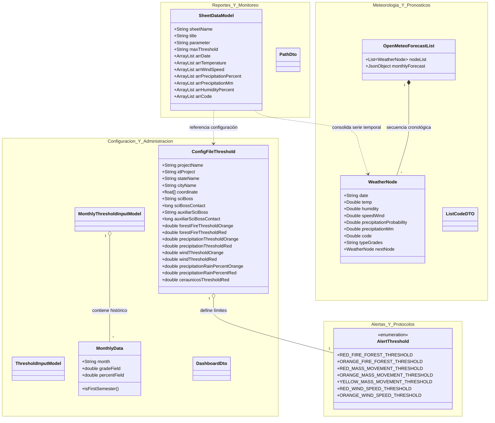

# Análisis de Dominio: Sistema de Monitoreo de Riesgos y Alerta Temprana (Sarada)

Este documento describe exclusivamente los **Actores** y las **Entidades/Modelos de Negocio** presentes en el dominio del proyecto, prescindiendo de aspectos tecnológicos, dependencias o arquitectura técnica.

---

## 1. Propósito General del Dominio
El negocio central de **Sarada** corresponde a un **Sistema de Alerta Temprana (SAT) y Monitoreo Hidrometeorológico**, enfocado en la prevención de riesgos y respuesta ante emergencias para proyectos u operaciones territoriales (orientado a la normativa y esquemas de Colombia).

El sistema vigila y contrasta pronósticos meteorológicos frente a umbrales configurados para cuatro amenazas principales:
1. **Incendios Forestales:** Monitoreo de temperaturas máximas y tendencias estacionales.
2. **Movimientos en Masa (Deslizamientos):** Monitoreo de precipitaciones acumuladas y probabilidad de lluvia.
3. **Vendavales:** Monitoreo de velocidades máximas del viento.
4. **Fenómenos Ceráunicos:** Monitoreo de tormentas eléctricas y densidad de descargas a tierra (DDT).

---

## 2. Actores del Dominio

Los actores identificados corresponden a los roles operativos del marco de **Comando de Incidentes (SCI)** y gestión del riesgo:

| Actor | Atributos Representativos | Rol en el Negocio |
|---|---|---|
| **Jefe SCI** (*Incident Command System Chief*) | Nombre (`sciBoss`), Teléfono/Contacto (`sciBossContact`) | Máxima autoridad operativa en la toma de decisiones. Es el receptor primario directo de las alertas tempranas automatizadas ante superación de umbrales. |
| **Auxiliar Jefe SCI** (*Deputy SCI Chief*) | Nombre (`auxiliarSciBoss`), Teléfono/Contacto (`auxiliarSciBossContact`) | Segundo al mando en la cadena operativa de comando; respalda al Jefe SCI y recibe notificaciones en la cadena de escalamiento. |
| **Brigadas de Emergencia** | *Cuerpo Operativo* | Equipos de primera respuesta en terreno. Entran en fase de **Alistamiento** con Alerta Naranja y en **Reacción Inmediata** con Alerta Roja. |
| **PMU (Puesto de Mando Unificado)** | *Instancia de Coordinación* | Órgano articulador interinstitucional que se activa preventivamente o formalmente cuando se disparan niveles críticos de alerta (Naranja / Roja). |

---

## 3. Clasificación de Entidades y Modelos de Negocio

Las entidades y modelos del dominio se estructuran en **cuatro dominios funcionales**:

---

### Grupo 1: Configuración, Ubicación y Administración Operativa
Modelos que representan las condiciones base del sitio monitoreado, los umbrales de disparo y las personas de contacto.

* `ConfigFileThreshold`:
  * **Propósito:** Entidad raíz que centraliza toda la configuración del proyecto a vigilar: identificación territorial (`stateName`, `cityName`, `coordinate`), contactos de emergencia del SCI y la matriz completa de umbrales diarios (Naranja y Rojo) para cada una de las 4 amenazas.
* `ThresholdInputModel`:
  * **Propósito:** Modelo de entrada y captura de datos que valida y transporta los parámetros del proyecto y los umbrales diarios antes de su persistencia.
* `MonthlyThresholdInputModel`:
  * **Propósito:** Modelo de configuración de umbrales climatológicos de mediano plazo (líneas base estacionales o semestrales para temperatura y precipitación en niveles Amarillo, Naranja y Rojo).
* `MonthlyData`:
  * **Propósito:** Representa el comportamiento histórico esperado para un mes específico (temperatura en grados y precipitación en porcentaje), evaluando reglas temporales como semestres.
* `DashboardDto`:
  * **Propósito:** Contiene las directrices de ejecución de la rutina de monitoreo (horario diario programado y destino de entrega de reportes).

---

### Grupo 2: Meteorología y Pronósticos
Entidades encargadas del modelado temporal y la tipificación de variables ambientales proyectadas.

* `WeatherNode`:
  * **Propósito:** Entidad atómica que modela el pronóstico diario de un punto geográfico (fecha, temperatura máxima, humedad relativa, velocidad de ráfaga de viento, probabilidad de precipitación, lámina de lluvia en mm y código WMO de condición atmosférica). Está encadenado cronológicamente con el siguiente día (`nextNode`).
* `OpenMeteoForecastList`:
  * **Propósito:** Colección agregada de pronósticos que consolida la ventana temporal completa de predicción (horizonte de 14 días y proyecciones mensuales).
* `ListCodeDTO`:
  * **Propósito:** Mapeo y catalogación de códigos climáticos estándar (WMO) a fenómenos observables (lluvia moderada, neblina, tormentas eléctricas, etc.). Vital para identificar descargas y condiciones ceráunicas.

---

### Grupo 3: Evaluación de Riesgo, Alertas y Protocolos
Modelos que estandarizan las directivas y acciones a seguir según la severidad.

* `AlertThreshold`:
  * **Propósito:** Catálogo formal de protocolos de acción en caso de alerta. Vincula cada nivel de severidad (Amarillo, Naranja, Rojo) y fenómeno específico con el mensaje o instrucción formal que debe transmitirse a los brigadistas y al PMU (ej. *"ACTIVAR EN PREVENTIVO EL PMU Y ALISTAMIENTO DE BRIGADAS DE EMERGENCIAS"*).

---

### Grupo 4: Generación de Reportes y Monitoreo Consolidado
Entidades que empaquetan la información evaluada para su registro y distribución.

* `SheetDataModel`:
  * **Propósito:** Entidad de agregación que representa la hoja de evaluación de una amenaza particular (ej. "INCENDIOS FORESTALES" o "MOVIMIENTOS EN MASA"). Cruza las series de tiempo meteorológicas con las directivas de alerta y los umbrales configurados para el proyecto.
* `PathDto`:
  * **Propósito:** Mantiene la referencia unificada del reporte diario consolidado emitido para la fecha activa.

---

## 4. Matriz Resumen de Entidades de Dominio

| Entidad / Modelo | Tipo | Clasificación de Dominio | Rol en el Negocio |
|---|---|---|---|
| `ConfigFileThreshold` | Entidad | Configuración & Ubicación | Configuración base del proyecto, actores del SCI y umbrales diarios |
| `ThresholdInputModel` | DTO / Modelo de Entrada | Configuración & Ubicación | Captura y validación de parámetros de configuración inicial |
| `MonthlyThresholdInputModel` | DTO / Modelo | Configuración & Climatología | Umbrales semestrales/estacionales de alerta por temperatura y lluvia |
| `MonthlyData` | Modelo / Registro | Configuración & Climatología | Registros mensuales de temperatura, precipitación y semestre |
| `DashboardDto` | Registro / DTO | Configuración & Monitoreo | Parámetros operacionales y de ejecución programada diaria |
| `WeatherNode` | Entidad | Meteorología & Pronóstico | Registro diario con métricas meteorológicas en serie temporal |
| `OpenMeteoForecastList` | Agregado / DTO | Meteorología & Pronóstico | Ventana completa de pronóstico (horizonte de 14 días y mensual) |
| `ListCodeDTO` | Catálogo / DTO | Meteorología & Fenómenos | Mapeo de fenómenos meteorológicos y detección de tormentas |
| `AlertThreshold` | Enumeración / Protocolo | Alertas & Protocolos | Acciones y directivas operativas estandarizadas de respuesta |
| `SheetDataModel` | Entidad / Agregado | Reportes & Monitoreo | Modelo analítico de evaluación de riesgo para cada amenaza |
| `PathDto` | Modelo de Estado | Reportes & Monitoreo | Referencia del entregable de evaluación del ciclo activo |
