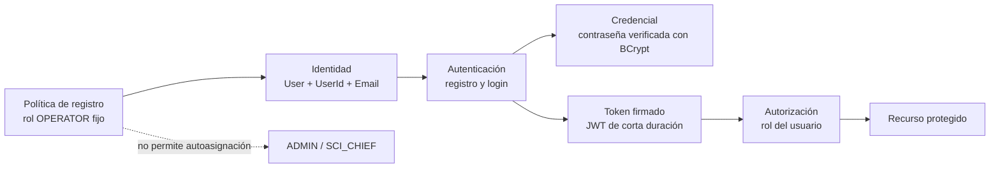
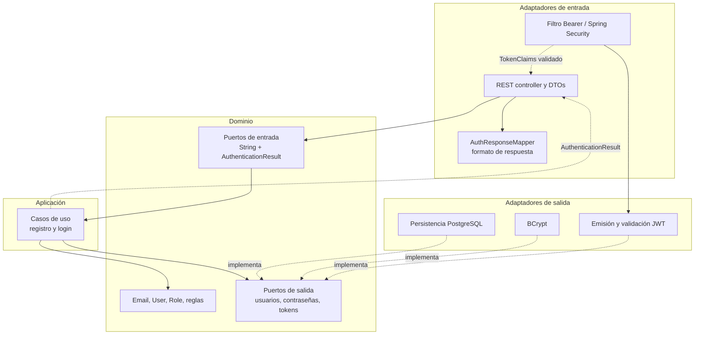
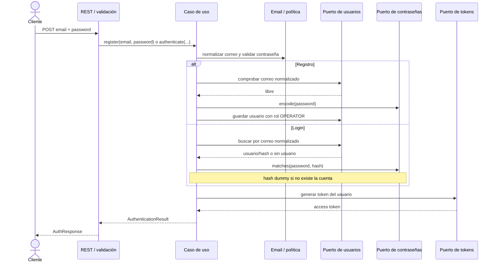
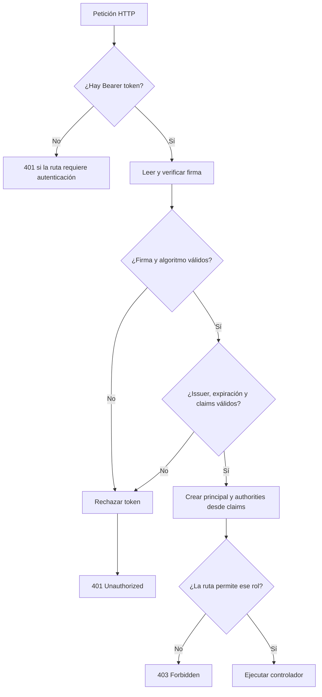

# IAM de Heimdall

IAM (*Identity and Access Management*) administra las cuentas que identifican a quienes usan Heimdall, comprueba sus credenciales y aporta el rol con el que las demás funciones deciden el acceso. El módulo mantiene separadas esas reglas de los detalles de HTTP, PostgreSQL, BCrypt, Spring Security y JWT.

## Conceptos



* **Identidad** es el usuario persistido, identificado por UUID, con correo normalizado, hash de contraseña y rol. El correo se recorta y convierte a minúsculas con `Locale.ROOT` antes de comprobar unicidad; así `Persona@ejemplo.com` y ` persona@ejemplo.com ` representan la misma cuenta.
* **Autenticación** demuestra que quien presenta una contraseña conoce el secreto asociado a esa cuenta. El servidor compara el texto recibido con un hash BCrypt; nunca necesita recuperar la contraseña original.
* **Autorización** decide qué operaciones permite el rol (`OPERATOR`, `SCI_CHIEF` o `ADMIN`). Un JWT válido identifica y autentica; por sí solo no significa que cada operación esté autorizada.
* **JWT** tiene cabecera, claims y firma separados por puntos. El contenido está codificado en Base64URL, no cifrado. No se deben incluir contraseñas ni secretos. La firma permite detectar cambios y el vencimiento acota cuánto tiempo se acepta el token.

## Capas y dependencias



La dirección de ejecución entra por HTTP y llega a la aplicación, que coordina reglas y puertos. La dependencia del código apunta hacia el dominio: los adaptadores implementan los puertos definidos en el núcleo. Esto permite cambiar Spring, el almacenamiento o la biblioteca JWT sin convertirlos en requisitos del modelo de usuario.

| Capa | Responsabilidad | Motivo de la decisión |
|---|---|---|
| Dominio | `User`, `Email`, `UserId`, `Role`, excepciones y contratos | Conserva identidad e invariantes sin importar Spring, JPA ni JWT. |
| Aplicación | Coordinar normalización, política de contraseña, persistencia, BCrypt y emisión de token | Mantiene el orden del caso de uso en un lugar comprobable y sustituible. |
| Infraestructura | Implementar base de datos, hash, firma JWT y configuración de seguridad | Encapsula decisiones técnicas y sus dependencias externas. |
| Presentación | Validar/convertir JSON, exponer rutas y traducir errores a HTTP | Evita que reglas de transporte HTTP se filtren al dominio. |

Los puertos de entrada reciben `String` para correo y contraseña y devuelven `AuthenticationResult` del dominio. Así el controlador no pasa DTOs de aplicación al núcleo ni el dominio depende de la capa que lo invoca. Los DTOs HTTP se transforman en la entrada y `AuthResponseMapper` convierte el resultado a una respuesta pública. El mapper vive en presentación; la configuración de infraestructura le entrega el `expiresIn` ya calculado, sin hacer que el controlador dependa de `JwtProperties`. Los puertos de salida describen lo que necesita el caso de uso; PostgreSQL, BCrypt y JWT proporcionan sus implementaciones.

### Decisiones por componente

| Parte | Decisión y motivo |
|---|---|
| Modelo de usuario | Los `record` son inmutables y validan invariantes al construirse. `UserId` genera UUID en el dominio para identificar al usuario antes de persistirlo. `Role` limita los valores admitidos a los tres roles del plan. |
| Correo | `Email` centraliza formato y normalización con `Locale.ROOT`; la consulta y el valor persistido usan exactamente la misma representación. Así la unicidad no depende de la capitalización recibida ni de la configuración regional del servidor. |
| Servicios de aplicación | Se construyen con puertos y no tienen anotaciones Spring. La política de contraseña vive aquí porque regula la entrada del caso de uso, mientras que `User` conserva únicamente el hash. Los DTOs de comandos ofrecen una entrada alternativa sin introducir dependencias hacia aplicación en los puertos del dominio. |
| Persistencia | `UserJpaEntity` concentra las anotaciones JPA; `UserPersistenceMapper` traduce explícitamente entre entidad y dominio. No se devuelve una entidad Hibernate desde los casos de uso, evitando carga diferida o exposición accidental de campos de persistencia en HTTP. |
| Correos concurrentes | La consulta previa permite detectar duplicados habituales. La restricción única resuelve carreras entre dos registros; `saveAndFlush` fuerza la detección antes de emitir el token. El adaptador traduce únicamente la restricción de correo conocida a conflicto de negocio y conserva otros fallos de integridad. |
| Composición | `IamConfiguration` construye servicios y mapper de respuestas. Spring administra sus instancias sin convertirse en una dependencia del dominio o de la aplicación, y la expiración se toma de una sola configuración JWT. |
| HTTP y errores | `@Valid` comprueba campos requeridos y tamaños; las reglas de negocio siguen aplicándose dentro del caso de uso. DTOs de respuesta seleccionan solo campos públicos y las respuestas de tokens llevan `Cache-Control: no-store`. Los errores no incorporan valores rechazados ni mensajes internos, que podrían contener secretos. |
| Representaciones para logs | Los `toString()` de usuario, comandos, resultados y configuración omiten hash, contraseña, token y secreto. Esta protección reduce filtraciones accidentales al registrar objetos completos. |

## Registro y login



Ambos endpoints aceptan `{ "email": "ana@example.com", "password": "..." }`. El registro valida el correo y la contraseña, rechaza el correo duplicado, guarda un hash BCrypt y asigna siempre `OPERATOR`; termina autenticando a la cuenta recién creada y devolviendo un token. La política de contraseña admite al menos 8 puntos de código Unicode y hasta 72 bytes UTF-8. BCrypt está configurado con coste 12 y genera su propio salt. El límite en bytes evita que BCrypt compare silenciosamente solo un prefijo de contraseñas largas.

En login, un correo mal formado, una contraseña inválida según la política, un usuario inexistente y una contraseña incorrecta producen el mismo error de credenciales. Para un correo válido inexistente se verifica contra un hash dummy, para aproximar el trabajo BCrypt de una contraseña incorrecta. Las entradas mal formadas se rechazan antes de BCrypt: mantienen la misma respuesta pública, pero no igualan exactamente el tiempo de procesamiento.

### API

| Método y ruta | Acceso | Entrada | Respuesta exitosa |
|---|---|---|---|
| `POST /api/v1/auth/register` | Público | `email`, `password` | `201` y `AuthResponse`; rol `OPERATOR` |
| `POST /api/v1/auth/login` | Público | `email`, `password` | `200` y `AuthResponse` |
| `GET /api/v1/auth/me` | JWT requerido | Header `Authorization: Bearer …` | `200`: `userId`, `email`, `role` |

`AuthResponse` contiene `accessToken`, `tokenType` (`Bearer`), `expiresIn` (segundos enteros), `userId`, `email` y `role`. `/me` proyecta el `TokenClaims` que el filtro ya verificó a `userId`, `email` y `role`; no hace una consulta adicional a la base de datos ni expone el hash de contraseña. Por eso sus datos representan la identidad y el rol al momento de emitir el token.

Ejemplos con `curl` (el primer ejemplo requiere un correo nuevo):

```sh
curl -i http://localhost:8080/api/v1/auth/register \
  -H 'Content-Type: application/json' \
  -d '{"email":"ana@example.com","password":"una-clave-segura"}'

curl -i http://localhost:8080/api/v1/auth/login \
  -H 'Content-Type: application/json' \
  -d '{"email":"ana@example.com","password":"una-clave-segura"}'

TOKEN='pegar-aqui-el-accessToken-recibido'
curl -i http://localhost:8080/api/v1/auth/me \
  -H "Authorization: Bearer $TOKEN"
```

## Validación JWT



El procesamiento de seguridad ocurre en cuatro pasos:

1. `SecurityConfiguration.securityFilterChain` desactiva sesiones, formulario, HTTP Basic, logout, caché de petición y CSRF; IAM autentica cada petición mediante bearer tokens. Solo los `POST` de registro y login son públicos. Las demás rutas requieren identidad; `@EnableMethodSecurity` permite añadir controles por método. El `JwtAuthenticationFilter` se instala antes del filtro de usuario/contraseña estándar. El entry point responde `401` y el handler de acceso denegado responde `403`.
2. `JwtAuthenticationFilter.doFilterInternal` busca `Authorization`, reconoce el prefijo `Bearer ` sin distinguir mayúsculas y espacios periféricos del token, y delega en `TokenServicePort.validateToken`. Si no hay bearer, deja continuar la cadena para que la regla de acceso determine si la ruta es pública. Si el token es inválido, limpia el contexto, escribe `401` y detiene la petición. Si es válido, instala los claims verificados como principal y crea la autoridad `ROLE_<rol>` antes de continuar.
3. `JwtTokenServiceAdapter.generateToken` toma el reloj UTC, trunca `iat` a segundos y firma con HS256 los claims mínimos: UUID en `sub`, `email`, `role`, `iss`, `iat` y `exp`. `exp` se calcula como `iat + HEIMDALL_JWT_EXPIRATION`; la verificación rechaza el token cuando `exp` no es posterior al instante actual. La contraseña no forma parte del token. `AuthResponseMapper` informa `expiresIn` con `Duration.toSeconds()`, en segundos enteros.
4. `JwtTokenServiceAdapter.validateToken` primero verifica la firma y exige el valor configurado de `issuer` con JJWT; también rechaza un algoritmo distinto de HS256. Después exige `iat` y `exp`, rechaza emisión futura, expiración no posterior a emisión o token vencido, comprueba que `sub` tenga formato textual UUID canónico y convierte `email` y `role` a modelos del dominio. Un error de parseo o estructura se traduce a `InvalidTokenException`, que el filtro presenta como `401`.

La clave firma y verifica el token; debe ser idéntica en todas las instancias que lo acepten. El principal se construye desde claims verificados sin consultar la base de datos en cada petición. `SecurityFilterChain` exige autenticación, y la autoridad `ROLE_<rol>` queda disponible para reglas de autorización; actualmente `/me` requiere identidad y no restringe el acceso por rol. `@EnableMethodSecurity` habilita agregar reglas por método cuando existan operaciones privilegiadas.

La autenticación y autorización tienen respuestas distintas: `401` indica que la petición no presentó credenciales válidas; `403` indica que el usuario fue autenticado, pero su rol no permite esa operación.

## Roles y altas privilegiadas

El registro público no recibe ni acepta un rol: cualquier intento de añadir `role: "ADMIN"` al JSON no debe cambiar la política fija `OPERATOR`. Esto evita que un usuario se eleve privilegios desde una ruta pública. `ADMIN` y `SCI_CHIEF` requieren asignación por un mecanismo administrativo controlado fuera del auto-registro, con autorización y auditoría propias. Los controladores deben proteger las operaciones privilegiadas por rol; conocer o modificar un claim del JWT no permite elevar privilegios porque la firma se verifica.

## Configuración

| Variable | Valor por defecto | Uso |
|---|---|---|
| `DB_URL` | `jdbc:postgresql://localhost:5432/heimdall` | URL JDBC de PostgreSQL. |
| `DB_USERNAME` | `heimdall` | Usuario de la base de datos. |
| `DB_PASSWORD` | Vacío (no útil para una instalación normal) | Contraseña de PostgreSQL; configurar explícitamente. |
| `HEIMDALL_JWT_SECRET` | Vacío (inválido para operar) | Secreto codificado en Base64, que al decodificarse debe contener al menos 32 bytes para HS256. |
| `HEIMDALL_JWT_EXPIRATION` | `PT15M` | Duración usada para calcular `exp` en formato `Duration` de Java; por defecto 15 minutos y mínimo un segundo. |
| `HEIMDALL_JWT_ISSUER` | `heimdall` | Emisor incluido y comprobado en el token. |

El secreto debe generarse aleatoriamente y entregarse al proceso mediante un gestor de secretos o variables protegidas. No se debe guardar en el repositorio ni ponerlo en ejemplos reales. Se puede generar localmente con `openssl rand -base64 32`; el comando produce 32 bytes aleatorios codificados en Base64. El valor generado es una credencial y debe tratarse como tal. La aplicación falla al iniciar si el secreto no es Base64 válido, contiene menos de 32 bytes decodificados, la expiración es menor a un segundo o el issuer queda vacío.

### Esquema y entorno de pruebas

El arranque ejecuta `src/main/resources/db/schema.sql` porque `spring.sql.init.mode=always`. El script crea `iam_users` con `IF NOT EXISTS`, una restricción única para el correo y un `CHECK` para los roles permitidos. Hibernate usa `ddl-auto=validate`: comprueba que el esquema coincida con las entidades, pero no crea ni modifica tablas. Si la tabla ya existe con una forma incompatible, `IF NOT EXISTS` no la repara y la validación de Hibernate debe fallar. Este bootstrap SQL cubre el alcance inicial de IAM; cuando el esquema evolucione, conviene migrarlo a scripts versionados con Flyway o Liquibase para tener cambios ordenados y repetibles.

El empaquetado completo también pasó con la tarea Gradle `build`, incluyendo `bootJar`, `jar` y `check`. El artefacto ejecutable queda en `build/libs/Heimdall-0.0.1-SNAPSHOT.jar`.

Las pruebas de integración que levantan Spring activan el perfil `test` con `@ActiveProfiles("test")`; este carga `src/test/resources/application-test.properties`, que configura H2 en modo de compatibilidad PostgreSQL. Así se prueban el bootstrap SQL, el mapeo y los endpoints sin una instancia externa. La tarea Gradle `test` completó 53 pruebas con 0 fallos, 0 errores y 0 omitidas. El [informe HTML de pruebas](../build/reports/tests/test/index.html) contiene el detalle.

La suite automática anterior usa H2. El 12 de octubre de 2026 también se verificó el arranque y el flujo HTTP contra PostgreSQL 17.11 real, como se detalla abajo; esa comprobación no reemplaza ejecutar toda la suite contra PostgreSQL.

## Errores HTTP

| Código | Significado | Ejemplos |
|---|---|---|
| `400 Bad Request` | JSON o campos del request inválidos | JSON mal formado, campos obligatorios ausentes o restricciones de tamaño; correo inválido en registro. |
| `401 Unauthorized` | No hay autenticación válida | Credenciales incorrectas o inválidas en login; bearer ausente, inválido, manipulado o vencido en ruta protegida. |
| `403 Forbidden` | Identidad válida sin permiso | `OPERATOR` intenta una acción limitada a `ADMIN` o `SCI_CHIEF`. |
| `409 Conflict` | Conflicto con estado existente | El correo normalizado ya está registrado. |

Las respuestas de autenticación no deben distinguir entre correo inexistente y contraseña incorrecta. Tampoco deben incluir contraseña, hash, secreto de firma ni detalles internos de excepción.

## Límites de JWT

El backend no conserva una sesión ni una lista inmediata de tokens revocados. Por tanto, al cerrar sesión, cambiar una contraseña o deshabilitar una cuenta, un access token ya emitido podría seguir aceptándose hasta `exp` (15 minutos por defecto). Cambiar la clave global invalidaría todos los tokens firmados con la anterior, no solo el de una persona.

El diseño descrito entrega access tokens y no define refresh tokens. Para renovar la sesión, el cliente debe volver a autenticarse. Si el producto requiere revocación inmediata o sesiones largas, debe añadirse deliberadamente un mecanismo de refresh con rotación y revocación, una versión de credenciales comprobada durante la autenticación, o una lista de revocación compartida; cada opción introduce estado y una decisión operativa adicional.

Como los claims de rol quedan fijados al emitir el token, un cambio de rol en la base de datos no modifica un token existente. El token puede conservar el rol anterior hasta su vencimiento, por lo que el TTL corto limita esa ventana. No incluir datos sensibles en los claims.

## Verificación de arranque con PostgreSQL real — 2026-10-12

El arranque inicial falló porque no había PostgreSQL disponible en `localhost:5432`; tampoco estaban configuradas las variables de credenciales y clave JWT. Se creó un PostgreSQL temporal de desarrollo en Podman (`heimdall-iam-dev-postgres`), publicado únicamente en `127.0.0.1:5432`. Se generaron una contraseña de base de datos y una clave JWT aleatorias en `/tmp/heimdall-dev.env`, con permisos `0600`, sin incorporarlas al repositorio.

La tarea Gradle `bootJar` generó el JAR ejecutable. Se inició con esas variables y `--server.address=127.0.0.1`; Tomcat escuchó en el puerto 8080 y Hibernate validó el esquema contra PostgreSQL 17.11. Los logs de esta ejecución están en `/tmp/heimdall-runtime.log`, el PID en `/tmp/heimdall-runtime.pid` y los resultados HTTP en `/tmp/heimdall-smoke-results.json`.

| Comprobación HTTP real | Resultado |
|---|---|
| Registro con correo normalizado e intento de aportar rol ADMIN | `201`, rol persistido `OPERATOR` |
| Login y consulta `/api/v1/auth/me` con JWT | `200`, misma identidad |
| Consulta protegida sin token o con token manipulado | `401` |
| Contraseña incorrecta y cuenta inexistente | `401`, misma respuesta pública |
| Registro de correo ya existente | `409` |
| Entrada inválida | `400` |
| Dos registros simultáneos del mismo correo | Uno `201` y otro `409` |

Una consulta SQL confirmó dos cuentas de prueba, ambas con hash BCrypt y rol `OPERATOR`. Se dejaron Spring y PostgreSQL ejecutándose al completar la verificación. Este entorno es temporal: el contenedor se creó con `--rm` y los archivos de `/tmp` no son una configuración persistente de desarrollo.

Para detener esta ejecución local:

```sh
kill "$(cat /tmp/heimdall-runtime.pid)"
podman stop heimdall-iam-dev-postgres
```
