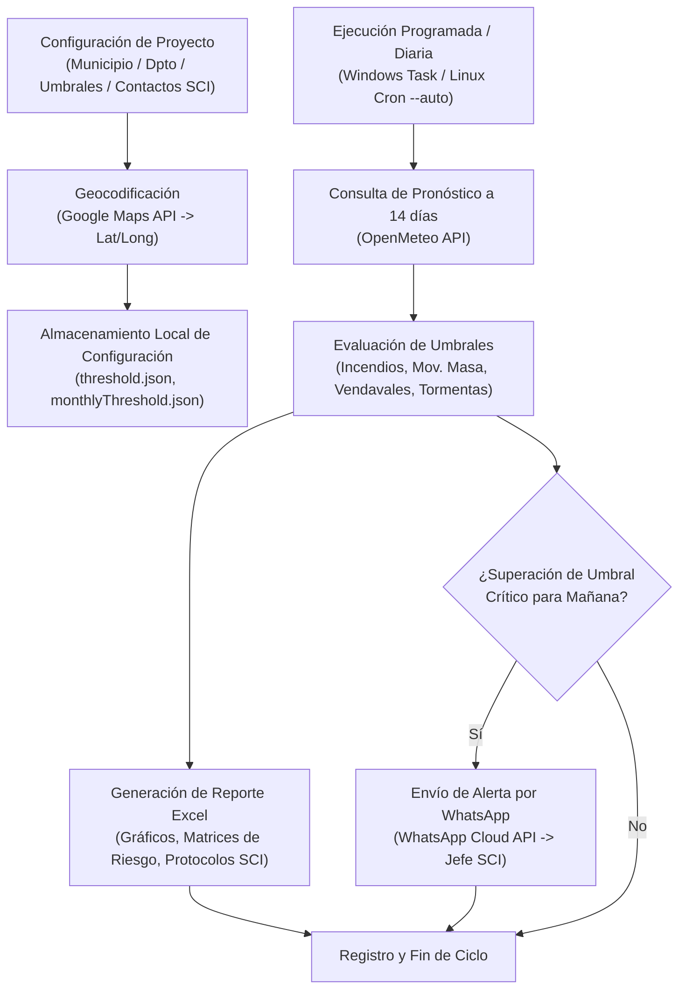

# Mapeo General del Proyecto: Sarada

Este documento presenta el mapeo general de funcionalidades, requerimientos, integraciones de APIs y estructura funcional del proyecto **Sarada**, centrándose exclusivamente en la lógica de negocio y automatizaciones, sin incluir patrones de diseño ni componentes de interfaz gráfica (JavaFX).

---

## 1. Funcionalidades Principales y Requerimientos

El sistema es un **Sistema de Alerta Temprana (SAT) y Monitoreo Hidrometeorológico** enfocado en cuatro amenazas críticas para la gestión del riesgo:
1. **Incendios Forestales:** Monitoreo y proyección de temperaturas máximas diarias (°C).
2. **Movimientos en Masa (Deslizamientos):** Evaluación de precipitación acumulada (mm) y probabilidad de lluvia (%).
3. **Vendavales:** Seguimiento de velocidades máximas de ráfagas de viento (km/h).
4. **Fenómenos Ceráunicos:** Detección de tormentas eléctricas y densidad de descargas a tierra (DDT).

---

### A. Geocodificación y Configuración Territorial
* **Requerimiento:** Determinar la ubicación espacial exacta de las operaciones o proyectos monitoreados a partir del Departamento y Municipio (Colombia).
* **Integración API:** Conexión con la **Google Maps Geocoding API** para obtener coordenadas geográficas (latitud y longitud).
* **Persistencia:** Almacena la configuración base en archivos JSON (`threshold.json`) que contienen la ubicación y los contactos de emergencia.

---

### B. Consumo y Procesamiento de Pronósticos Climáticos
* **Requerimiento:** Obtener proyecciones climáticas continuas para contrastarlas con los umbrales de alerta del proyecto.
* **Integración API:** Consulta a la API de **OpenMeteo Forecast**.
* **Alcance:**
  * Ventana de predicción de **14 días**.
  * Variables consultadas: temperatura máxima a 2m, velocidad de viento a 10m, probabilidad de precipitación, lámina de lluvia acumulada (mm), humedad relativa media y código de condición atmosférica (código estándar WMO).

---

### C. Evaluación de Riesgos y Generación de Reportes en Excel
* **Requerimiento:** Consolidar las mediciones climáticas, comparar con umbrales configurados y emitir la evaluación del riesgo en un libro de trabajo Excel (`report-YYYY-MM-DD.xlsx`).
* **Alcance Funcional del Reporte:**
  * **Hojas por cada tipo de amenaza:** Secciones dedicadas a Incendios Forestales, Movimientos en Masa, Vendavales y Fenómenos Ceráunicos.
  * **Gráficas de Series Temporales:** Curvas de proyección climática frente a las líneas de umbral de Alerta Naranja y Alerta Roja, además de los promedios semestrales.
  * **Matriz de Alerta y Protocolo:** Clasificación del nivel de riesgo detectado (Amarillo, Naranja o Rojo) y asociación automática de las directivas operativas de emergencia (activación preventiva del PMU, alistamiento de brigadas, etc.).
  * **Cadena de Notificación:** Definición de los contactos del Sistema de Comando de Incidentes (Jefe SCI y Auxiliar).

---

### D. Notificación de Alertas Tempranas por WhatsApp
* **Requerimiento:** Disparar notificaciones automatizadas e inmediatas al personal responsable ante la inminencia de una alerta.
* **Integración API:** Conexión con **Meta WhatsApp Cloud API**.
* **Lógica Operativa:**
  * Monitorea el registro histórico y la predicción del día siguiente (`LocalDate.now().plusDays(1)`).
  * Si se prevé la superación de un umbral crítico, despacha una plantilla de mensaje oficial de alerta temprana directamente al teléfono del Jefe SCI (`sciBossContact`).

---

### E. Automatización y Programación Desatendida (Scheduling)
* **Requerimiento:** El sistema debe operar de forma automática en segundo plano (modo `--auto`) a una hora determinada del día (HH:mm) para generar los reportes y notificar alertas sin intervención humana.
* **Mecanismos de Automatización:**
  * **En Entornos Windows:** Registro de tareas programadas nativas del sistema operativo (`schtasks`).
  * **En Entornos Linux:** Configuración e instalación de entradas periódicas en el planificador `crontab`.

---

## 2. Mapa de Integraciones y Servicios Externos

| Servicio / API | Propósito en el Negocio | Datos Involucrados |
|---|---|---|
| **Google Maps Geocoding API** | Georreferenciación de proyectos territoriales | Entrada: Municipio y Departamento.  Salida: Coordenadas (Latitud, Longitud). |
| **OpenMeteo Forecast API** | Provisión de pronósticos meteorológicos de 14 días | Parámetros: Temperatura, viento, lluvia (mm y %), humedad y código WMO. |
| **Meta WhatsApp Cloud API** | Notificación inmediata de alertas críticas | Destinatario: Contactos SCI.  Contenido: Plantilla de superación de umbrales. |
| **Planificador de Tareas del SO** | Ejecución periódica y desatendida del monitoreo | Tareas nativas de Windows (`schtasks`) y Linux (`crontab`). |

---

## 3. Resumen de Flujo de Operación

