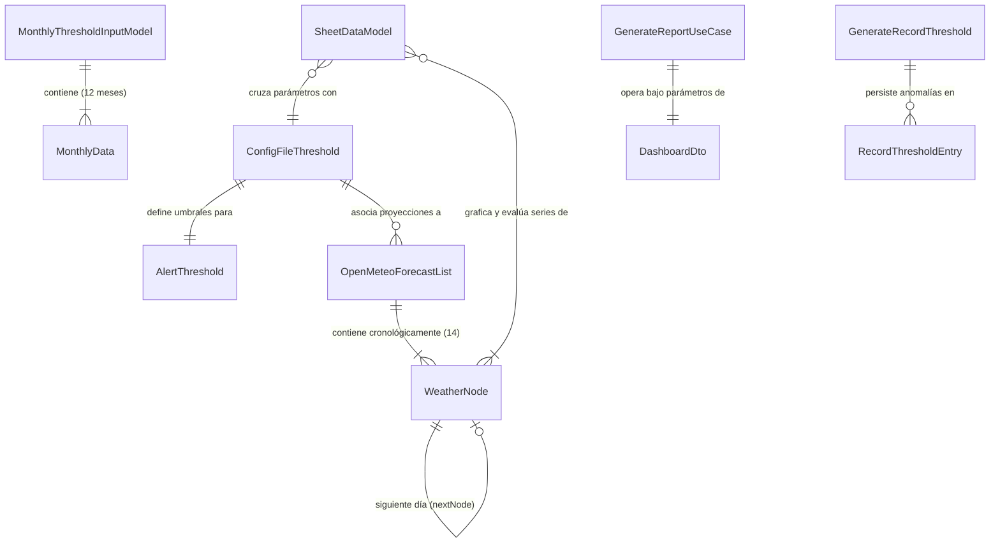

# Inventario Factual Exhaustivo del Dominio Sarada

Este documento constituye el inventario factual y detallado del dominio del sistema de escritorio original **Sarada** (Sistema de Alerta Temprana y Monitoreo Hidrometeorológico en Colombia), base funcional para el diseño del modelo de dominio de **Heimdall**.

Toda la información registrada proviene estrictamente de la documentación del proyecto (`ANALISIS_DOMINIO.md`, `MAPEO_GENERAL.md`) y ha sido contrastada de forma fáctica y exhaustiva con el código fuente y artefactos originales de Sarada (`/home/danielcoronel/Projects/Sarada`). Cualquier deducción, implicación o aspecto no documentado explícitamente se encuentra identificado como **`[INFERIDO]`**.

---

## 1. Glosario de Términos del Dominio

* **SAT (Sistema de Alerta Temprana):** Conjunto integrado y coordinado de capacidades, instrumentos, personas y procedimientos diseñado para monitorear, predecir y emitir avisos anticipados sobre eventos y amenazas hidrometeorológicas potencialmente destructivas, permitiendo a los responsables y a las comunidades actuar a tiempo para reducir el riesgo.
* **SCI (Sistema de Comando de Incidentes):** Metodología estandarizada a nivel internacional para el mando, control y coordinación de la respuesta ante emergencias y operaciones en terreno, integrando instalaciones, personal, equipos y protocolos bajo una jerarquía organizacional clara.
* **PMU (Puesto de Mando Unificado):** Instancia colegiada de articulación y coordinación interinstitucional en Colombia donde las máximas autoridades (alcaldía, comités de gestión del riesgo, organismos de socorro, líderes operativos de obra) toman decisiones concertadas y de alto nivel ante emergencias de gravedad o gran magnitud.
* **Jefe SCI / Comandante de Incidentes (`sciBoss`):** Máxima autoridad operativa responsable de liderar la gestión del incidente en terreno, definir estrategias de respuesta, aprobar recursos y determinar la elevación o desactivación de niveles de alarma. Es el destinatario primario directo de las alertas automáticas de Sarada.
* **Auxiliar Jefe SCI / Jefe de Área (`auxiliarSciBoss`):** Segundo al mando dentro de la jerarquía del SCI que respalda operativamente al Jefe SCI, forma parte de la cadena de notificación telefónica y lo releva en caso de ausencia.
* **Brigadas de Emergencia:** Grupos operativos de primera respuesta conformados y capacitados en el sitio del proyecto para la prevención, mitigación y control directo de emergencias (incendios, deslizamientos, afectaciones por tormentas).
* **DDT (Densidad de Descargas a Tierra):** Variable física ceráunica que mide el número de rayos o descargas eléctricas atmosféricas que impactan en tierra por kilómetro cuadrado al año ($\text{rayos}/\text{km}^2/\text{año}$). Utilizada como parámetro normativo para evaluar el nivel de exposición ante tormentas eléctricas.
* **WMO (Organización Meteorológica Mundial / *World Meteorological Organization*):** Organismo internacional que normaliza los estándares meteorológicos mundiales, incluyendo la tabla oficial de códigos numéricos (0 a 99) para identificar condiciones atmosféricas (cielos despejados, tipos de lluvia, nieve, niebla y tormentas eléctricas).
* **Lámina de lluvia / Precipitación acumulada (mm):** Medida hidrometeorológica que expresa el volumen de lluvia acumulado sobre una superficie horizontal plana en un tiempo dado, medida en milímetros de altura ($1\text{ mm} = 1\text{ litro por metro cuadrado}$).
* **Probabilidad de precipitación (%):** Indicador probabilístico porcentual que estima la probabilidad de que ocurra precipitación cuantificable en el punto geográfico durante la ventana de tiempo diaria proyectada.
* **Ráfaga / Velocidad del viento (km/h):** Medición de la velocidad del flujo de aire proyectada a 10 metros de altura sobre la superficie del terreno (`wind_speed_10m_max`), utilizada para diagnosticar el riesgo de vendavales y daños estructurales.
* **Fenómeno ceráunico:** Suceso meteorológico caracterizado por actividad electromagnética violenta en la atmósfera que produce relámpagos, truenos y descargas nube-tierra o nube-nube.
* **Alistamiento de brigadas:** Protocolo y estado preventivo en el cual las brigadas de emergencia suspenden labores no críticas, verifican su equipamiento de rescate/extinción, comprueban radios de comunicación y se concentran en puntos de espera prestas para despliegue.
* **Reacción inmediata:** Protocolo y estado de máxima alerta donde el personal operativo se moviliza de forma instantánea al sitio de la contingencia para iniciar maniobras de respuesta directa y salvamento.
* **Línea base climatológica mensual:** Registro de promedios históricos esperados (temperatura y precipitación) para cada mes del año contra los cuales se contrastan las predicciones para identificar anomalías estacionales.
* **Semestre (Etapa / Stage):** Segmentación temporal semestral utilizada en la climatología de Sarada: Semestre 1 (enero a junio, `stage = 1`) y Semestre 2 (julio a diciembre, `stage = 2`).

---

## 2. Entidades y Modelos de Sarada

A continuación se detalla cada entidad y modelo identificado en la documentación y verificado en la estructura original de clases de Sarada:

### 2.1. `ConfigFileThreshold`
* **Paquete original:** `com.solproe.business.domain`
* **Tipo:** Entidad de Dominio / Raíz de Configuración
* **Propósito:** Entidad central que define y persiste la configuración completa de un proyecto vigilado: ubicación territorial, contactos operativos de mando SCI y matriz completa de umbrales diarios de alerta temprana.
* **Campos:**
  * `projectName` (`String`): Nombre descriptivo del proyecto monitoreado. *(Nota técnica de código original: en la serialización JSON de Sarada se asignaba por error `idProject` a este campo, pero su rol conceptual de dominio es el nombre del proyecto)*.
  * `idProject` (`String`): Identificador único o código de referencia del proyecto.
  * `stateName` (`String`): Nombre del Departamento de Colombia donde se ubica el proyecto (e.g. "Antioquia").
  * `cityName` (`String`): Nombre del Municipio de Colombia donde se ubica el proyecto (e.g. "Buriticá").
  * `coordinate` (`float[]` en memoria / `location: {lat, lng}` en `threshold.json`): Coordenadas geográficas del proyecto obtenidas por geocodificación (`coordinate[0]` o `lat` = latitud; `coordinate[1]` o `lng` = longitud).
  * `sciBoss` (`String`): Nombre completo del Jefe del Sistema de Comando de Incidentes.
  * `sciBossContact` (`long`): Número telefónico móvil del Jefe SCI al que se despachan las alertas por WhatsApp (ej. `3013338304`).
  * `auxiliarSciBoss` (`String`): Nombre del Auxiliar del Jefe SCI / Jefe de Área.
  * `auxiliarSciBossContact` (`long`): Número telefónico de contacto del Auxiliar del Jefe SCI.
  * `forestFireThresholdOrange` (`double`): Umbral de temperatura diaria para Alerta Naranja por incendios forestales (°C).
  * `forestFireThresholdRed` (`double`): Umbral de temperatura diaria para Alerta Roja por incendios forestales (°C).
  * `precipitationThresholdOrange` (`double`): Umbral de lámina de lluvia diaria para Alerta Naranja por movimientos en masa (mm).
  * `precipitationThresholdRed` (`double`): Umbral de lámina de lluvia diaria para Alerta Roja por movimientos en masa (mm).
  * `precipitationRainPercentOrange` (`double`): Umbral de probabilidad de lluvia diaria para Alerta Naranja por deslizamientos (%).
  * `precipitationRainPercentRed` (`double`): Umbral de probabilidad de lluvia diaria para Alerta Roja por deslizamientos (%).
  * `windThresholdOrange` (`double`): Umbral de velocidad de viento diaria para Alerta Naranja por vendavales (km/h).
  * `windThresholdRed` (`double`): Umbral de velocidad de viento diaria para Alerta Roja por vendavales (km/h).
  * `ceraunicosThresholdRed` (`double`): Umbral diario de Alerta Roja por fenómenos ceráunicos (código WMO asociado a tormenta eléctrica).

### 2.2. `ThresholdInputModel`
* **Paquete original:** `com.solproe.business.dto`
* **Tipo:** DTO de Entrada (*Data Transfer Object*)
* **Propósito:** Capturar y transportar los parámetros de configuración ingresados en la interfaz gráfica antes de invocar la geocodificación de coordenadas y su posterior persistencia.
* **Campos:** Contiene los mismos campos que `ConfigFileThreshold` excepto `coordinate` (el cual es derivado de la geocodificación posterior):
  * `projectName` (`String`)
  * `stateName` (`String`)
  * `cityName` (`String`)
  * `idProject` (`String`)
  * `sciBoss` (`String`)
  * `sciBossContact` (`long`)
  * `auxiliarSciBoss` (`String`)
  * `auxiliarSciBossContact` (`long`)
  * `forestFireThresholdOrange` (`double`)
  * `forestFireThresholdRed` (`double`)
  * `precipitationThresholdOrange` (`double`)
  * `precipitationThresholdRed` (`double`)
  * `windThresholdOrange` (`double`)
  * `windThresholdRed` (`double`)
  * `precipitationRainPercentOrange` (`double`)
  * `precipitationRainPercentRed` (`double`)
  * `ceraunicosThresholdRed` (`double`)

### 2.3. `MonthlyThresholdInputModel`
* **Paquete original:** `com.solproe.business.dto`
* **Tipo:** DTO / Modelo de Configuración Climatológica
* **Propósito:** Agrupar los umbrales de alerta de mediano plazo (mensuales/estacionales) y la lista de comportamientos climatológicos proyectados para los 12 meses.
* **Campos:**
  * `orangeTemperatureThreshold` (`double` / en JSON `orangeThresholdTemperature`): Umbral mensual de temperatura máxima promedio para Alerta Naranja (°C).
  * `redTemperatureThreshold` (`double` / en JSON `redThresholdTemperature`): Umbral mensual de temperatura máxima promedio para Alerta Roja (°C).
  * `orangePrecipitationThreshold` (`double` / en JSON `orangeThresholdPrecipitation`): Umbral mensual de precipitación para Alerta Naranja (%).
  * `redPrecipitationThreshold` (`double` / en JSON `redThresholdPrecipitation`): Umbral mensual de precipitación para Alerta Roja (%).
  * `yellowPrecipitationThreshold` (`double` / en JSON `yellowThresholdPrecipitation`): Umbral mensual de precipitación para Alerta Amarilla (%).
  * `monthlyData` (`List<MonthlyData>`): Lista de los 12 registros mensuales con datos de temperatura y lluvia esperados.

### 2.4. `MonthlyData`
* **Paquete original:** `com.solproe.business.dto`
* **Tipo:** Modelo de Registro Mensual
* **Propósito:** Representar los valores climatológicos de referencia para un mes particular y evaluar reglas de semestre.
* **Campos y Métodos:**
  * `month` (`String`): Nombre del mes en español (e.g. "enero", "febrero", etc.).
  * `gradeField` (`TextField` en UI de escritorio / `double` en dominio lógico): Componente/valor que contiene la temperatura máxima mensual promedio (°C), leída con `getGrade()`.
  * `percentField` (`TextField` en UI de escritorio / `double` en dominio lógico): Componente/valor que contiene la precipitación máxima mensual promedio (%), leída con `getPercent()`.
  * `isFirstSemester()` (`boolean`): Regla de negocio que evalúa si el mes pertenece al primer semestre (enero, febrero, marzo, abril, mayo, junio). *(Nota técnica: en el código original se detectó la errata `"may0"` en el switch de comparación)*.

### 2.5. `DashboardDto`
* **Paquete original:** `com.solproe.business.dto` (declarado como `record`)
* **Tipo:** DTO de Ejecución y Monitoreo
* **Propósito:** Contener las directrices operacionales para la rutina de monitoreo desatendido diario.
* **Campos:**
  * `token` (`String`): Token de autenticación de Meta WhatsApp Cloud API (Bearer token).
  * `hour` (`String`): Hora del día programada para la ejecución automática (formato "HH", valores 00 a 23).
  * `minute` (`String`): Minuto de la hora programado para la ejecución automática (formato "mm", valores 00 a 59).
  * `directory` (`String`): Ruta absoluta del directorio en el sistema de archivos donde se guardarán los informes Excel generados.

### 2.6. `WeatherNode`
* **Paquete original:** `com.solproe.business.domain`
* **Tipo:** Entidad de Dominio / Nodo Cronológico
* **Propósito:** Modela el pronóstico del tiempo para una fecha diaria específica, operando internamente como un nodo de lista enlazada simple para estructurar cronológicamente el horizonte temporal.
* **Campos:**
  * `date` (`String`): Fecha del pronóstico en formato ISO `"YYYY-MM-DD"`.
  * `temp` (`Double`): Temperatura máxima prevista a 2 metros (`temperature_2m_max`, en °C).
  * `speedWind` (`Double`): Velocidad máxima de viento / ráfaga prevista a 10 metros (`wind_speed_10m_max`, en km/h).
  * `typeGrades` (`String`): Unidad o escala de medición de temperatura (`[INFERIDO]: reservado para unidad de medida, usualmente "°C"`).
  * `humidity` (`Double`): Humedad relativa media prevista a 2 metros (`relative_humidity_2m_mean`, en %).
  * `precipitationProbability` (`Double` / método getter `getPrecipitation()`): Probabilidad máxima de lluvia diaria (`precipitation_probability_max`, en %).
  * `precipitationMm` (`Double`): Lámina acumulada de precipitación proyectada (`precipitation_sum`, en mm).
  * `code` (`Double`): Código numérico de condición atmosférica estandarizado por WMO (`weather_code`).
  * `nextNode` (`WeatherNode`): Puntero al pronóstico del día subsiguiente.

### 2.7. `OpenMeteoForecastList`
* **Paquete original:** `com.solproe.business.dto`
* **Tipo:** Agregado / DTO Colección
* **Propósito:** Encapsular la colección completa de pronósticos de la ventana meteorológica (14 días diarios) junto con proyecciones mensuales complementarias.
* **Campos:**
  * `nodeList` (`List<WeatherNode>`): Lista cronológica de 14 pronósticos diarios.
  * `monthlyForecast` (`JsonObject`): Estructura JSON para proyecciones climatológicas mensuales o datos extendidos.

### 2.8. `ListCodeDTO`
* **Paquete original:** `com.solproe.business.dto`
* **Tipo:** DTO Catálogo de Fenómenos WMO
* **Propósito:** Mapear y parametrizar los códigos climáticos estándar de la WMO con su significado textual y operacional. Se usa un patrón *Builder* con reflexión para persistirlo en `listCode.json`.
* **Campos (todos de tipo `Integer`):**
  * `clearSky`: Código WMO para "Cielo despejado" (código estándar 0).
  * `mainlyClear`: Código WMO para "Principalmente despejado" (código estándar 1).
  * `partlyCloudy`: Código WMO para "Parcialmente nublado" (código estándar 2).
  * `overcast`: Código WMO para "Nublado" (código estándar 3).
  * `fog`: Código WMO para "Niebla" (código estándar 45).
  * `depositingRimeFog`: Código WMO para "Niebla de rima depositante" (código estándar 48).
  * `lightDrizzle`: Código WMO para "Llovizna ligera" (código estándar 51).
  * `moderateDrizzle`: Código WMO para "Llovizna moderada" (código estándar 53).
  * `denseIntensityDrizzle`: Código WMO para "Llovizna densa intensidad" (código estándar 55).
  * `lightFreezingDrizzle`: Código WMO para "Llovizna helada ligera" (código estándar 56).
  * `heavyIntensityFreezingDrizzle`: Código WMO para "Llovizna helada densa intensidad" (código estándar 57).
  * `slightRain`: Código WMO para "Lluvia ligera" (código estándar 61).
  * `moderateRain`: Código WMO para "Lluvia moderada" (código estándar 63).
  * `heavyIntensityRain`: Código WMO para "Lluvia fuerte" (código estándar 65).
  * `slightSnowFall`: Código WMO para "Nevada ligera" (código estándar 71).
  * `moderateSnowfall`: Código WMO para "Nevada moderada" (código estándar 73).
  * `heavyIntensitySnowFall`: Código WMO para "Nevada fuerte" (código estándar 75).
  * `snowGrains`: Código WMO para "Granos de nieve" (código estándar 77).
  * `slightRainShower`: Código WMO para "Aguacero ligero" (código estándar 80).
  * `moderateRainShower`: Código WMO para "Aguacero moderado" (código estándar 81).
  * `violentRainShower`: Código WMO para "Aguacero violento" (código estándar 82).
  * `slightSnowShower`: Código WMO para "Nevada aislada ligera" (código estándar 85).
  * `heavySnowShower`: Código WMO para "Nevada aislada fuerte" (código estándar 86).
  * `thunderstorm`: Código WMO para "Tormenta eléctrica ligera" (códigos estándar 95/96/99; clave para disparar Alerta Roja de ceráunicos).

### 2.9. `AlertThreshold`
* **Paquete original:** `com.solproe.business.dto`
* **Tipo:** Enumeración de Protocolos Operativos
* **Propósito:** Catálogo oficial inmutable de directivas y acciones de respuesta ante emergencias según la amenaza y nivel de severidad.
* **Constantes:**
  * `RED_FIRE_FOREST_THRESHOLD`
  * `ORANGE_FIRE_FOREST_THRESHOLD`
  * `RED_MASS_MOVEMENT_THRESHOLD`
  * `ORANGE_MASS_MOVEMENT_THRESHOLD`
  * `YELLOW_MASS_MOVEMENT_THRESHOLD`
  * `RED_WIND_SPEED_THRESHOLD`
  * `ORANGE_WIND_SPEED_THRESHOLD`
  *(Nota: contiene el campo interno `mensaje` de tipo `String` y método `getMessage()`)*.

### 2.10. `SheetDataModel`
* **Paquete original:** `com.solproe.business.domain`
* **Tipo:** Entidad de Agregación para Reportes
* **Propósito:** Consolidar todas las series de tiempo meteorológicas, tipos de amenaza y configuraciones de umbrales necesarios para generar una pestaña del reporte Excel.
* **Campos:**
  * `sheetName` (`String`): Nombre de la pestaña de la hoja de cálculo ("INCENDIOS FORESTALES", "MOVIMIENTOS EN MASA", "VENDAVALES", "CERAUNICO").
  * `title` (`String`): Título institucional del bloque de monitoreo en la hoja.
  * `parameter` (`String`): Identificador textual del parámetro evaluado (e.g. "TEMPERATURA PROMEDIO DIARIA EN °C").
  * `arrDate` (`ArrayList<String>`): Serie cronológica de fechas de los 14 días.
  * `arrTemperature` (`ArrayList<Double>`): Serie de temperaturas diarias.
  * `arrWindSpeed` (`ArrayList<Double>`): Serie de velocidades de viento diarias.
  * `arrPrecipitationPercent` (`ArrayList<Double>`): Serie de probabilidades de lluvia diarias.
  * `arrPrecipitationMm` (`ArrayList<Double>`): Serie de láminas de lluvia acumulada en mm.
  * `arrHumidityPercent` (`ArrayList<Double>`): Serie de humedad relativa diaria.
  * `arrCode` (`ArrayList<Double>`): Serie de códigos WMO diarios.
  * `configFileThreshold` (`JsonObject[]`): Configuración consolidada en 3 posiciones: `[0]` = `threshold.json` (diario), `[1]` = `monthlyThreshold.json` (mensual), `[2]` = `listCode.json` (códigos climáticos).
  * `reportType` (`TypeReportSheet`): Clasificador enum de la amenaza asociada a la hoja (`forestFireDataModel`, `massMovementDataModel`, `rainShowerDataModel`, `ceraunic`).
  * `startRow` (`int`): Fila inicial donde se inserta el contenido en la plantilla Excel.
  * `parameterCol` (`int[]`): Columnas donde se posicionan las variables en la hoja.
  * `maxThreshold` (`String`): Título descriptivo para la fila de umbral climatológico mensual.

### 2.11. `PathDto`
* **Paquete original:** `com.solproe.business.dto`
* **Tipo:** Singleton de Estado Operacional
* **Propósito:** Mantener en memoria la ruta estática resuelta del archivo Excel generado en el ciclo diario activo (`report-YYYY-MM-DD.xlsx`).
* **Campos:**
  * `path` (`static Path`): Instancia estática de la ruta del reporte emitido.

### 2.12. Otros Modelos y Tipos detectados en el código de Sarada
* `TypeReportSheet` (`enum` en `com.solproe.service.excel`): Define los 4 tipos de reportes de hoja: `forestFireDataModel`, `massMovementDataModel`, `rainShowerDataModel`, `ceraunic`.
* `WeatherNodeList` (`com.solproe.business.domain`): Estructura de lista enlazada simple propia con atributos `firstNode` y `lastNode` de tipo `WeatherNode`.
* `CellRangeDTO` (`com.solproe.business.dto`): DTO con `sheetName`, `startRow`, `endRow`, `startCol`, `endCol` para delimitar regiones de celdas en Excel.
* `ConfigurationDTO` (`com.solproe.business.dto`): Modelo legado que implementa `ConfigFileInterface` con atributos `locationName`, `latitude`, `longitude`, `temperatureThreshold`, `daysCount`.
* `WeatherForecastNode` (`com.solproe.business.dto`): DTO alternativo con `temp`, `date`, `precipitation`, `humidity`.
* `GoogleResolveGeocodingEnt` (`com.solproe.business.domain`): Clase vacía reservada para geocodificación.
* `OsPaths` (`enum` en `com.solproe.business.domain`): Enumeración vacía reservada para rutas de SO.
* `AlertMessages` (`enum` en `com.solproe.business.domain`): Enumeración vacía en la base de código original.
* `PathGlobal` (`com.solproe.shared`): Singleton utilitario de almacenamiento de ruta `Path path`.

---

## 3. Amenazas

El dominio monitorea y evalúa cuatro amenazas hidrometeorológicas:

| Amenaza | Variables Monitoreadas | Unidad | Niveles de Alerta Existentes | Temporalidad de Umbrales | Valores Numéricos Encontrados en Código/Tests |
|---|---|---|---|---|---|
| **1. Incendios Forestales** | Temperatura máxima diaria a 2m | Grados Celsius (°C) | • **Naranja**<br>• **Roja** *(Amarillo no definido)* | • **Diario:** Umbrales Naranja y Rojo.<br>• **Mensual:** Umbrales Naranja y Rojo contra promedios mensuales de 6 meses. | En `FormControllerTest`:<br>• Naranja diario: **25.0 °C**<br>• Rojo diario: **27.0 °C** |
| **2. Movimientos en Masa (Deslizamientos)** | • Lámina de lluvia acumulada<br>• Probabilidad de lluvia | • Milímetros (mm)<br>• Porcentaje (%) | • **Amarillo** (mensual y protocolo Excel)<br>• **Naranja** (diario y mensual)<br>• **Roja** (diario y mensual) | • **Diario:** Umbrales Naranja y Rojo tanto para mm como para % de lluvia.<br>• **Mensual:** Umbrales Amarillo, Naranja y Rojo para % promedio mensual. | En `FormControllerTest`:<br>• Lluvia Naranja: **20.0 mm**<br>• Lluvia Rojo: **39.0 mm**<br>• Prob. lluvia Naranja: **50.0 %**<br>• Prob. lluvia Rojo: **75.0 %** |
| **3. Vendavales** | Velocidad máxima de ráfaga de viento a 10m | Kilómetros por hora (km/h) | • **Naranja**<br>• **Roja** *(Amarillo no definido)* | • **Diario:** Umbrales Naranja y Rojo.<br>• **Mensual:** No aplica / no evaluado. | En `FormControllerTest`:<br>• Viento Naranja: **40.0 km/h**<br>• Viento Rojo: **50.0 km/h** |
| **4. Fenómenos Ceráunicos** | • Código de tormenta eléctrica WMO (`thunderstorm`)<br>• Densidad de Descargas a Tierra (DDT) | • Código numérico WMO (adimensional)<br>• DDT ($\text{rayos}/\text{km}^2/\text{año}$) [teórico] | • **Roja** exclusivamente *(Ni Amarillo ni Naranja aplican)* | • **Diario:** Umbral Rojo por detección de condición de tormenta.<br>• **Mensual:** No aplica / no evaluado. | En `FormControllerTest`:<br>• Ceráunicos Rojo: código WMO **96** (Tormenta eléctrica con granizo) |

---

## 4. Niveles de Alerta y Protocolos

### 4.1. Textos Oficiales de la Enumeración `AlertThreshold`
Estos textos representan las directivas institucionales base definidas en el enum:

1. **`RED_FIRE_FOREST_THRESHOLD` (Incendio Forestal - Alerta Roja):**
   > `"ACTIVAR EN PREVENTIVO EL PMU Y ALISTAMIENTO DE BRIGADAS DE EMERGENCIAS (EQUIPOS LISTOS PARA REACCIÓN INMEDIATA)"`
2. **`ORANGE_FIRE_FOREST_THRESHOLD` (Incendio Forestal - Alerta Naranja):**
   > `"ALISTAMIENTO DE BRIGADAS DE EMERGENCIAS"`
3. **`RED_MASS_MOVEMENT_THRESHOLD` (Movimiento en Masa - Alerta Roja):**
   > `"ACTIVAR EN PREVENTIVO EL PMU Y ALISTAMIENTO DE BRIGADAS DE EMERGENCIAS (EQUIPOS LISTOS PARA REACCIÓN INMEDIATA)"`
4. **`ORANGE_MASS_MOVEMENT_THRESHOLD` (Movimiento en Masa - Alerta Naranja):**
   > `"ALISTAMIENTO DE BRIGADAS DE EMERGENCIAS"`
5. **`YELLOW_MASS_MOVEMENT_THRESHOLD` (Movimiento en Masa - Alerta Amarilla):**
   > `"PREPARACIÓN PARA LA RESPUESTA, ALISTAMIENTO DE RECURSOS, SUMINISTROS Y SERVICIOS E IDENTIFICACIÓN DE DE LAS RUTAS DE INGRESO Y EGRESO."` *(Nota: incluye la duplicación textual `"DE DE LAS"` original)*.
6. **`RED_WIND_SPEED_THRESHOLD` (Vendavales - Alerta Roja):**
   > `"ACTIVAR EN PREVENTIVO EL PMU Y ALISTAMIENTO DE BRIGADAS DE EMERGENCIAS (EQUIPOS LISTOS PARA REACCIÓN INMEDIATA)"`
7. **`ORANGE_WIND_SPEED_THRESHOLD` (Vendavales - Alerta Naranja):**
   > `"ALISTAMIENTO DE BRIGADAS DE EMERGENCIAS"`
8. **Fenómenos Ceráunicos - Alerta Roja (Generador de Reportes):**
   > `"ACTIVAR EN PREVENTIVO EL PMU Y ALISTAMIENTO DE BRIGADAS DE EMERGENCIAS (EQUIPOS LISTOS PARA REACCIÓN INMEDIATA) ALERTA ROJA POR FENÓMENOS CERÁUNICOS"`

---

### 4.2. Cadenas de Llamado y Mensajes Operativos en Reportes Excel
En la generación de reportes Excel (`GenerateSectionSheet.java`), cada amenaza y nivel asocia un tipo de alerta, una directiva de llamada telefónica y un mensaje operativo formal:

#### A. Incendios Forestales
* **Alerta Naranja (Monitoreo Diario):**
  * *Tipo de alerta:* `"ALERTA POR POR IDENTIFICACION DE LECTURAS ANÓMALAS EN MONITOREO DIARIO PARA NIVEL DE ALERTA NARANJA \n"`
  * *Cadena de llamado:* `"Comunicar de manera inmediata al jefe del sistema de comando de incidentes y al Jefe de Área y/o Auxiliar del Comandante de Incidentes al número telefónico indicando nivel de alerta Naranja "`
  * *Mensaje formal:* `"ALISTAMIENTO DE BRIGADAS PARA LA ATENCIÓN DE EMERGENCIAS POR ALERTA NARANJA DE INCENDIO FORESTAL"`
* **Alerta Roja (Monitoreo Diario):**
  * *Tipo de alerta:* `"ALERTA POR IDENTIFICACIÓN DE LECTURAS ANÓMALAS EN MONITOREO DIARIO PARA NIVEL DE ALERTA ROJA\n"`
  * *Cadena de llamado:* `"Comunicar de manera inmediata al jefe del sistema de comando de incidentes y al Jefe de Área y/o Auxiliar del Comandante de Incidentes al número telefónico indicando nivel de alerta Roja y activación de mecanismos de alarma"`
  * *Mensaje formal:* `"ACTIVACIÓN DE CADENAS DE LLAMADO, ORDENAR LA VERIFICACIÓN DE OCURRENCIA DEL EVENTO Y DAR INICIO A LAS ACCIONES DE RESPUESTA INMEDIATA  POR ALERTA ROJA DE INCENDIO FORESTAL. SI EL EVENTO ES DE GRAN MAGNITUD SOLICITAR LA INSTALACIÓN DE PMU."`
* **Alerta Naranja (Monitoreo Mensual):**
  * *Tipo de alerta:* `"ALERTA NARANJA POR IDENTIFICACION DE MES PREVISTO DE AUMENTO ANÓMALO EN EL VALOR PROMEDIO DE LAS LECTURAS DE TEMPERATURA EN MONITOREO MENSUAL\n"`
  * *Cadena de llamado:* `"Comunicar de manera inmediata al jefe del sistema de comando de incidentes y al Jefe de Área y/o Auxiliar del Comandante de Incidentes al número telefónico:"`
  * *Mensaje formal:* `"ALISTAMIENTO DE BRIGADAS PARA LA ATENCIÓN DE EMERGENCIAS POR ALERTA NARANJA DE INCENDIO FORESTAL"`
* **Alerta Roja (Monitoreo Mensual):**
  * *Tipo de alerta:* `"ALERTA ROJA POR IDENTIFICACION DE MES PREVISTOS DE AUMENTO ANÓMALO EN EL VALOR PROMEDIO DE LAS LECTURAS DE TEMPERATURA EN MONITOREO MENSUAL\n"`
  * *Cadena de llamado:* `"Comunicar de manera inmediata al jefe del sistema de comando de incidentes y al Jefe de Área y/o Auxiliar del Comandante de Incidentes al número telefónico:"`
  * *Mensaje formal:* `"ACTIVACIÓN DE CADENAS DE LLAMADO, ORDENAR LA VERIFICACIÓN DE OCURRENCIA DEL EVENTO Y DAR INICIO A LAS ACCIONES DE RESPUESTA INMEDIATA  POR ALERTA ROJA DE INCENDIO FORESTAL. SI EL EVENTO ES DE GRAN MAGNITUD SOLICITAR LA INSTALACIÓN DE PMU."`

#### B. Movimientos en Masa (Deslizamientos)
* **Alerta Naranja (Monitoreo Diario):**
  * *Tipo de alerta:* `"ALERTA POR IDENTIFICACION DE LECTURAS ANÓMALAS EN MONITOREO DIARIO PARA NIVEL DE ALERTA NARANJA \n"`
  * *Cadena de llamado:* `"Comunicar de manera inmediata al jefe del sistema de comando de incidentes y al Jefe de Área y/o Auxiliar del Comandante de Incidentes al número telefónico indicando nivel de alerta Naranja "`
  * *Mensaje formal:* `"ALISTAMIENTO DE BRIGADAS PARA LA ATENCIÓN DE EMERGENCIAS POR ALERTA NARANJA DE MOVIMIENTOS EN MASA"`
* **Alerta Roja (Monitoreo Diario):**
  * *Tipo de alerta:* `"ALERTA POR IDENTIFICACIÓN DE LECTURAS ANÓMALAS EN MONITOREO DIARIO PARA NIVEL DE ALERTA ROJA\n"`
  * *Cadena de llamado:* `"Comunicar de manera inmediata al jefe del sistema de comando de incidentes y al Jefe de Área y/o Auxiliar del Comandante de Incidentes al número telefónico indicando nivel de alerta Roja y activación de mecanismos de alarma"`
  * *Mensaje formal:* `"ACTIVACIÓN DE CADENAS DE LLAMADO, ORDENAR LA VERIFICACIÓN DE OCURRENCIA DEL EVENTO Y DAR INICIO A LAS ACCIONES DE RESPUESTA INMEDIATA  POR ALERTA ROJA DE MOVIMIENTOS EN MASA. SI EL EVENTO ES DE GRAN MAGNITUD SOLICITAR LA INSTALACIÓN DE PMU."`
* **Alerta Naranja (Monitoreo Mensual):**
  * *Tipo de alerta:* `"ALERTA NARANJA POR IDENTIFICACION DE MES PREVISTO DE AUMENTO ANÓMALO EN EL VALOR PROMEDIO DE LAS LECTURAS DE TEMPERATURA EN MONITOREO MENSUAL\n"` *(Nota: el código original arrastra erróneamente el texto "TEMPERATURA" en vez de "PRECIPITACIÓN")*.
  * *Cadena de llamado:* `"Comunicar de manera inmediata al jefe del sistema de comando de incidentes y al Jefe de Área y/o Auxiliar del Comandante de Incidentes al número telefónico:  "`
  * *Mensaje formal:* `"ALISTAMIENTO DE BRIGADAS PARA LA ATENCIÓN DE EMERGENCIAS POR ALERTA NARANJA DE MOVIMIENTOS EN MASA"`
* **Alerta Roja (Monitoreo Mensual):**
  * *Tipo de alerta:* `"ALERTA ROJA POR IDENTIFICACION DE MES PREVISTOS DE AUMENTO ANÓMALO EN EL VALOR PROMEDIO DE LAS LECTURAS DE TEMPERATURA EN MONITOREO MENSUAL\n"`
  * *Cadena de llamado:* `"Comunicar de manera inmediata al jefe del sistema de comando de incidentes y al Jefe de Área y/o Auxiliar del Comandante de Incidentes al número telefónico:  "`
  * *Mensaje formal:* `"ACTIVACIÓN DE CADENAS DE LLAMADO, ORDENAR LA VERIFICACIÓN DE OCURRENCIA DEL EVENTO Y DAR INICIO A LAS ACCIONES DE RESPUESTA INMEDIATA  POR ALERTA ROJA DE MOVIMIENTOS EN MASA. SI EL EVENTO ES DE GRAN MAGNITUD SOLICITAR LA INSTALACIÓN DE PMU."`

#### C. Vendavales
* **Alerta Naranja:**
  * *Cadena de llamado:* `"Comunicar de manera inmediata al jefe del sistema de comando de incidentes y al Jefe de Área y/o Auxiliar del Comandante de Incidentes al número telefónico indicando nivel de alerta Naranja "`
  * *Mensaje formal:* `"ALISTAMIENTO DE BRIGADAS PARA LA ATENCIÓN DE EMERGENCIAS POR ALERTA NARANJA DE VENDAVALES"`
* **Alerta Roja:**
  * *Cadena de llamado:* `"Comunicar de manera inmediata al jefe del sistema de comando de incidentes y al Jefe de Área y/o Auxiliar del Comandante de Incidentes al número telefónico indicando nivel de alerta Roja y activación de mecanismos de alarma"`
  * *Mensaje formal:* `"ACTIVACIÓN DE CADENAS DE LLAMADO, ORDENAR LA VERIFICACIÓN DE OCURRENCIA DEL EVENTO Y DAR INICIO A LAS ACCIONES DE RESPUESTA INMEDIATA  POR ALERTA ROJA DE VENDAVALES. SI EL EVENTO ES DE GRAN MAGNITUD SOLICITAR LA INSTALACIÓN DE PMU."`
  *(Nota técnica: en `GenerateSectionSheet.java` líneas 770-781 los arrays `notification` y `message` se encuentran invertidos respecto a las demás amenazas)*.

#### D. Fenómenos Ceráunicos
* **Alerta Roja:**
  * *Tipo de alerta:* `"ALERTA POR IDENTIFICACIÓN DE LECTURAS ANÓMALAS EN MONITOREO DIARIO PARA NIVEL DE ALERTA ROJA"`
  * *Cadena de llamado:* `"Comunicar de manera inmediata al jefe del sistema de comando de incidentes y al Jefe de Área y/o Auxiliar del Comandante de Incidentes al número telefónico indicando nivel de alerta Roja y activación de mecanismos de alarma"`
  * *Mensaje formal:* `"ACTIVAR EN PREVENTIVO EL PMU Y ALISTAMIENTO DE BRIGADAS DE EMERGENCIAS (EQUIPOS LISTOS PARA REACCIÓN INMEDIATA) ALERTA ROJA POR FENÓMENOS CERÁUNICOS"`

---

## 5. Actores y Roles

| Actor / Instancia | Atributos Representativos | ¿Qué Recibe? | ¿Qué Hace en el Negocio? |
|---|---|---|---|
| **Jefe SCI** (*Comandante de Incidentes*) | `sciBoss` (`String`), `sciBossContact` (`long`) | Mensajes automatizados de alerta temprana por WhatsApp (`alert_threshold`) cuando se prevé superación de umbrales para el día de mañana (`LocalDate.now().plusDays(1)`). | • Máxima autoridad operativa en la toma de decisiones.<br>• Recibe la alerta temprana y revisa el informe técnico Excel diario.<br>• Ordena la verificación en terreno del evento esperado.<br>• Dispara las cadenas de llamado y ordena el alistamiento de las brigadas.<br>• Solicita la instalación formal del PMU en situaciones de gran magnitud. |
| **Auxiliar Jefe SCI** (*Jefe de Área / Subcomandante*) | `auxiliarSciBoss` (`String`), `auxiliarSciBossContact` (`long`) | Contacto registrado en la matriz de llamado del reporte Excel (`[INFERIDO]: no recibe WhatsApp automatizado en el código original de Sarada; es llamado por el Jefe SCI`). | • Asiste de manera directa al Jefe SCI en el puesto de mando.<br>• Actúa como relevo operativo inmediato.<br>• Participa en la cadena de comunicación telefónica.<br>• Coordina las inspecciones de campo y el alistamiento material de las brigadas. |
| **Brigadas de Emergencia** | Personal operativo de brigada en campo | Instrucciones y órdenes operativas a través de la cadena de llamado telefónico y alarmas. | • **En Alerta Amarilla:** Alistamiento de recursos, suministros, herramientas e identificación preventiva de rutas de ingreso y egreso.<br>• **En Alerta Naranja:** Estado de concentración y alistamiento preventivo con equipos verificados para respuesta.<br>• **En Alerta Roja:** Despliegue operativo inmediato en terreno (*reacción inmediata*) para control del evento y labores de salvamento. |
| **PMU (Puesto de Mando Unificado)** | Instancia de coordinación territorial e interinstitucional | Solicitud formal de activación preventiva o de instalación por parte del Jefe SCI ante Alerta Roja o eventos mayores. | • Integra a las autoridades gubernamentales, comités de gestión del riesgo, organismos de socorro (bomberos, defensa civil) y gerencia del proyecto.<br>• Toma decisiones estratégicas superiores (evacuaciones masivas, declaratoria de calamidad, cierre de vías, movilización de ayuda externa). |

---

## 6. Integraciones Externas

Sarada interactúa con cuatro servicios e interfaces externas:

### 6.1. Google Maps Geocoding API
* **Propósito:** Georreferenciación automatizada de las operaciones para obtener la latitud y longitud a partir de la división político-administrativa (Municipio y Departamento).
* **Endpoint HTTP:**
  `GET https://maps.googleapis.com/maps/api/geocode/json?address={cityName},{stateName}, Colombia&key={apiKey}`
* **Datos consumidos:**
  * Parámetros de entrada: `cityName` (Municipio), `stateName` (Departamento), país fijo `"Colombia"`, `apiKey` de Google Cloud.
* **Datos producidos:**
  * Extrae de la respuesta JSON el objeto de coordenadas:
    `results[0].geometry.location.lat` (float) y `results[0].geometry.location.lng` (float).
  * Produce la estructura `"location": {"lat": ..., "lng": ...}` persistida en `threshold.json`.

---

### 6.2. OpenMeteo Forecast API
* **Propósito:** Provisión de predicciones meteorológicas diarias de alta resolución geográfica basadas en modelos climáticos numéricos globales para una ventana temporal de 14 días.
* **Endpoint HTTP:**
  `GET https://api.open-meteo.com/v1/forecast?latitude={lat}&longitude={lon}&daily=temperature_2m_max,weather_code,wind_speed_10m_max,precipitation_probability_max,relative_humidity_2m_mean,precipitation_sum&forecast_days=14`
* **Parámetros de consulta enviados:**
  * `latitude`: Latitud en punto flotante.
  * `longitude`: Longitud en punto flotante.
  * `daily`: Lista de variables requeridas:
    * `temperature_2m_max`: Temperatura máxima a 2 metros (°C).
    * `wind_speed_10m_max`: Velocidad máxima de ráfaga de viento a 10 metros (km/h).
    * `precipitation_probability_max`: Probabilidad máxima diaria de precipitación (%).
    * `precipitation_sum`: Lámina diaria de precipitación acumulada (mm).
    * `relative_humidity_2m_mean`: Humedad relativa media diaria (%).
    * `weather_code`: Código numérico meteorológico estándar WMO.
  * `forecast_days`: Ventana fija de predicción: `14`.
* **Datos consumidos y producidos:**
  * Consume el objeto JSON bajo la clave `daily`, conteniendo los arreglos temporales correspondientes a cada variable.
  * Produce el agregado `OpenMeteoForecastList` conteniendo una secuencia cronológica de 14 instancias de `WeatherNode`.

---

### 6.3. Meta WhatsApp Cloud API
* **Propósito:** Notificación inmediata, directa y desatendida de alertas tempranas críticas al teléfono del Jefe SCI.
* **Endpoint HTTP:**
  `POST https://graph.facebook.com/v22.0/{phoneNumberId}/messages`
* **Encabezados:**
  * `Authorization: Bearer {token}` (obtenido de `dashboard.json`)
  * `Content-Type: application/json`
* **Identificador de número emisor (`phoneNumberId`):** `"105793722275227"` (configurable o por defecto).
* **Destinatario (`to`):** `"57" + sciBossContact` (prefijo telefónico internacional de Colombia `57` concatenado con el número móvil del Jefe SCI).
* **Plantilla oficial (`template`):**
  * Nombre: `"alert_threshold"`
  * Idioma: `{"code": "en"}`
  * Componentes:
    1. **`header` (tipo `text`):** Título corto del nivel y tipo de alerta disparada:
       * `"Naranja Incendio Forestal"`
       * `"Roja Incendio Forestal"`
       * `"Naranja Deslizamiento"`
       * `"Roja Deslizamiento"`
       * `"Naranja Vendaval"`
       * `"Roja Vendaval"`
    2. **`body` (tipo `text`):** Dos parámetros posicionales:
       * Parámetro 1: Texto completo de la directiva y protocolo operativo (obtenido de `AlertThreshold.*.getMessage()`).
       * Parámetro 2: Fecha de ocurrencia esperada del evento anómalo (`YYYY-MM-DD`).
* **Estructura completa del payload JSON:**
  ```json
  {
    "messaging_product": "whatsapp",
    "to": "573013338304",
    "type": "template",
    "template": {
      "name": "alert_threshold",
      "language": { "code": "en" },
      "components": [
        {
          "type": "header",
          "parameters": [
            { "type": "text", "text": "Roja Incendio Forestal" }
          ]
        },
        {
          "type": "body",
          "parameters": [
            { "type": "text", "text": "ACTIVAR EN PREVENTIVO EL PMU Y ALISTAMIENTO DE BRIGADAS DE EMERGENCIAS (EQUIPOS LISTOS PARA REACCIÓN INMEDIATA)" },
            { "type": "text", "text": "2026-10-15" }
          ]
        }
      ]
    }
  }
  ```

---

### 6.4. Generador de Reportes Excel (Apache POI)
* **Propósito:** Generar el libro de trabajo analítico de entrega formal que consolida pronósticos climáticos, gráficos de curvas frente a umbrales, tablas de anomalías y protocolos de comando de incidentes.
* **Archivo producido:** `report-YYYY-MM-DD.xlsx` (nombrado con la fecha del día de ejecución).
* **Directorio de salida:** Especificado por el usuario en `dashboard.json` (`directory`).
* **Estructura del libro de trabajo (5 pestañas en total):**
  1. `"INCENDIOS FORESTALES"`: Monitoreo de temperatura máxima diaria y promedios mensuales.
  2. `"MOVIMIENTOS EN MASA"`: Monitoreo de lámina de lluvia (mm), probabilidad de lluvia (%) y promedios mensuales.
  3. `"VENDAVALES"`: Monitoreo de velocidad máxima de viento (km/h).
  4. `"CERAUNICO"`: Monitoreo de tormentas eléctricas según códigos WMO.
  5. `"support data"`: Pestaña de soporte técnico que almacena las tablas numéricas que alimentan las series y gráficos de POI (`forestFireThresholdOrange`, `forestFireThresholdRed`, `precipitationRainPercent*`, `precipitationThreshold*`, `windThreshold*`, umbrales mensuales y ceráunicos).
* **Componentes de cada hoja pública:**
  * Bloque de título y encabezado institucional.
  * Gráfico de líneas (POI *LineChart*) contrastando la serie temporal de 14 días contra las líneas fijas de Alerta Naranja y Alerta Roja.
  * Tabla de "Fechas de lectura anómala" detectadas en el horizonte.
  * Tabla de "Sistema de Alertas" y "Acciones por Nivel de Alerta".
  * Tabla de "Nivel de Alerta para los próximos 6 meses" (para incendios y movimientos en masa).
  * Cuadro de "Mecanismos de notificación y aviso previo" con la cadena de llamado y teléfonos del Jefe SCI y Auxiliar.

---

### 6.5. Planificador de Tareas del Sistema Operativo (Scheduling)
* **Propósito:** Asegurar la ejecución periódica y desatendida del comando diario en segundo plano sin requerir un demonio permanente de Sarada.
* **Mecanismos por plataforma:**
  * **Windows (`schtasks.exe`):**
    * Comando ejecutado:
      `schtasks /create /tn autoGenerateExcelReport /tr "\"C:\Program Files\Sarada\Sarada.exe\" --auto" /sc DAILY /st HH:mm /sd 28/10/2025 /f /rl HIGHEST`
  * **Linux (`crontab`):**
    * Modificación de la tabla crontab del usuario agregando la línea:
      `{mm} {HH} * * * Sarada --auto # autoGenerateExcelReport`

---

## 7. Flujos y Procesos Paso a Paso

### 7.1. Flujo de Configuración Inicial del Proyecto
1. **Captura de Datos del Proyecto y Umbrales Diarios:**
   * El usuario ingresa en la pantalla de configuración (`create-file-config.fxml`): Nombre del Proyecto, Departamento, Municipio, ID Proyecto, nombres y números telefónicos del Jefe SCI y Auxiliar Jefe SCI, y los umbrales diarios (temperatura naranja/roja, lluvia mm naranja/roja, lluvia % naranja/roja, viento naranja/rojo y ceráunicos rojo).
2. **Geocodificación Territorial:**
   * La aplicación (`CreateConfigFileUseCase`) consume la Google Maps Geocoding API enviando `cityName + "," + stateName + ", Colombia"`.
   * Al recibir la respuesta HTTP, extrae las coordenadas `location.lat` y `location.lng`.
3. **Persistencia de Configuración Diaria:**
   * Se almacena el archivo `.Sarada/threshold.json` con la información del proyecto, las coordenadas y la matriz de umbrales diarios.
4. **Captura y Persistencia de Climatología Mensual:**
   * En `monthly-file-config.fxml`, el usuario ingresa la matriz de 12 meses (temperatura y lluvia promedio esperada) y define los umbrales mensuales de Alerta Naranja y Roja de temperatura, y Amarillo, Naranja y Rojo de precipitación.
   * Se evalúa si el primer mes corresponde al primer semestre para asignar el campo `stage` (1 o 2).
   * Se guarda el archivo `.Sarada/monthlyThreshold.json`.
5. **Configuración de Catálogo WMO:**
   * Se configuran los códigos meteorológicos en `listCode.json` a partir de `ListCodeDTO`.
6. **Configuración del Dashboard y Tarea Programada:**
   * El usuario ingresa en `dashboard.fxml` la hora y minuto deseados (`hour`, `minute`), la ruta de almacenamiento de reportes (`directory`) y el token de WhatsApp.
   * Se guarda `.Sarada/dashboard.json`.
   * Se registra la tarea periódica en el programador de tareas del SO (`schtasks` en Windows o `crontab` en Linux) apuntando a la ejecución del comando con bandera `--auto`.

---

### 7.2. Flujo de Ejecución Diaria Desatendida (Modo `--auto`)
1. **Activación:**
   * El programador del SO invoca el ejecutable a la hora programada: `Sarada --auto`.
2. **Arranque:**
   * `App.main` detecta el argumento `--auto`, inicializa los logs (`LogInitializer.init()`) y crea la instancia de `GenerateReportUseCase`.
3. **Lectura de Archivos Locales:**
   * El caso de uso lee los archivos JSON almacenados en la carpeta `.Sarada/`:
     * `threshold.json` (coordenadas, contactos y umbrales diarios).
     * `monthlyThreshold.json` (umbrales mensuales).
     * `listCode.json` (códigos WMO).
     * `recordThreshold.json` (histórico de anomalías previas).
     * `dashboard.json` (token y directorio de reportes).
4. **Consulta a OpenMeteo:**
   * Extrae `lat` y `lon` de `threshold.json`.
   * Construye y ejecuta la petición GET a OpenMeteo Forecast pidiendo las 6 variables meteorológicas diarias a 14 días.
5. **Procesamiento de Pronóstico:**
   * `OpenMeteoAdapterJson` convierte la respuesta JSON en un agregado `OpenMeteoForecastList` con 14 instancias de `WeatherNode`.
6. **Generación del Reporte Excel:**
   * Se calcula la fecha actual (`LocalDate.now()`).
   * Se construye el nombre de archivo `report-YYYY-MM-DD.xlsx` en el directorio configurado y se registra en `PathDto`.
   * `ReportExcelGenerator` crea las hojas de cálculo para Incendios Forestales, Movimientos en Masa, Vendavales, Ceráunicos y la hoja de soporte de datos (`support data`).
   * Durante la generación, se evalúan las anomalías diarias contra los umbrales de cada amenaza.
7. **Registro de Anomalías:**
   * Para cada fecha que supere un umbral crítico (Naranja o Rojo), `GenerateRecordThreshold` registra o actualiza la fecha en `.Sarada/recordThreshold.json`, asociando el contacto del Jefe SCI y el nombre del umbral vulnerado.
8. **Evaluación y Disparo de Alerta Temprana por WhatsApp:**
   * `WhatsappBusinessService.sendMessage()` examina las fechas registradas en `recordThreshold.json`.
   * Llama a `ValidateDate.compareActualDate(dateKey)`, comparando la fecha de anomalía contra el día siguiente (`LocalDate.now().plusDays(1)`).
   * Si existe superación de umbral prevista para el día de mañana, se mapea la anomalía al mensaje de directiva oficial y se envía el mensaje de plantilla `alert_threshold` vía WhatsApp al Jefe SCI (`57 + sciBossContact`).
9. **Finalización:**
   * El archivo Excel queda disponible en disco, el mensaje de WhatsApp se emite y el proceso finaliza.

---

### 7.3. Flujo de Evaluación de Umbrales Meteorológicos
* **Evaluación Diaria (Horizonte de 14 días):**
  * Para cada día $i \in \{0, \dots, 13\}$:
    * **Incendios Forestales:**
      * Si $T_i \ge \text{forestFireThresholdRed}$ $\rightarrow$ Registra Alerta Roja (`"forestFireThresholdRed"`).
      * Si $\text{forestFireThresholdOrange} \le T_i < \text{forestFireThresholdRed}$ $\rightarrow$ Registra Alerta Naranja (`"forestFireThresholdOrange"`).
    * **Movimientos en Masa (Probabilidad de Lluvia %):**
      * Si $P_i \ge \text{precipitationRainPercentRed}$ $\rightarrow$ Registra Alerta Roja (`"precipitationRainPercentRed"`).
      * Si $\text{precipitationRainPercentOrange} \le P_i < \text{precipitationRainPercentRed}$ $\rightarrow$ Registra Alerta Naranja (`"precipitationRainPercentOrange"`).
    * **Movimientos en Masa (Lámina de Lluvia mm):**
      * Si $M_i \ge \text{precipitationThresholdRed}$ $\rightarrow$ Alerta Roja en reporte.
      * Si $\text{precipitationThresholdOrange} \le M_i < \text{precipitationThresholdRed}$ $\rightarrow$ Alerta Naranja en reporte.
    * **Vendavales:**
      * Si $V_i \ge \text{windThresholdOrange}$ $\rightarrow$ Registra Alerta Naranja (`"windThresholdOrange"`). *(Nota: Alerta Roja diaria de vendavales en el código de registro Excel no se evaluó explícitamente en el if, aunque WhatsApp sí contempla `"windThresholdRed"`)*.
    * **Fenómenos Ceráunicos:**
      * Si el código meteorológico del día coincide o supera el código WMO de tormenta eléctrica (`thunderstorm`) $\rightarrow$ Alerta Roja.
* **Evaluación Climatológica Mensual (Próximos 6 meses):**
  * Se compara cada mes contra `redThresholdTemperature` / `orangeThresholdTemperature` (para incendios) y contra `redThresholdPrecipitation` / `orangeThresholdPrecipitation` / `yellowThresholdPrecipitation` (para movimientos en masa).

---

## 8. Reglas de Negocio Explícitas

1. **Horizonte temporal de pronóstico fijado en 14 días:** La consulta al proveedor meteorológico solicita siempre 14 días de predicción diaria (`forecast_days=14`).
2. **Evaluación de alertas WhatsApp orientada al día siguiente (`today + 1`):** El sistema automatizado de mensajería evalúa e informa alertas críticas únicamente si la condición meteorológica anómala está prevista para ocurrir exactamente al día siguiente de la corrida (`LocalDate.now().plusDays(1)`).
3. **Formato telefónico internacional obligatorio:** Para la mensajería de WhatsApp, el número de contacto de emergencia debe incluir el indicativo de país de Colombia `57` (`"57" + sciBossContact`).
4. **Monitoreo exclusivo de Alerta Roja para fenómenos ceráunicos:** Ante condiciones de tormenta eléctrica no existen fases previas de Alerta Amarilla o Naranja; la detección del código meteorológico de tormenta dispara de forma automática e inmediata la Alerta Roja.
5. **Comportamiento ante Alerta Amarilla:** Exclusiva para la amenaza de Movimientos en Masa en escala mensual/preparatoria. Implica alistamiento de insumos, verificación de recursos y delimitación de rutas de ingreso y egreso.
6. **Comportamiento ante Alerta Naranja:** Dispara de manera imperativa el alistamiento formal de las brigadas de emergencia y la notificación al Jefe y Auxiliar SCI.
7. **Comportamiento ante Alerta Roja:** Exige la activación de las cadenas de llamado, verificación inmediata del evento, respuesta operativa en terreno y la activación preventiva o solicitud formal de instalación del Puesto de Mando Unificado (PMU).
8. **Condición de intervalo semiabierto para Alerta Naranja:** En el análisis cuantitativo diario, una variable se clasifica en Alerta Naranja si supera o iguala el umbral naranja pero es estrictamente menor al umbral rojo ($U_{\text{naranja}} \le X < U_{\text{rojo}}$). Si alcanza o supera el umbral rojo ($X \ge U_{\text{rojo}}$), se clasifica como Alerta Roja.
9. **Nomenclatura y destino del entregable Excel:** El archivo consolidado debe nombrarse exactamente con el patrón `report-YYYY-MM-DD.xlsx` basado en la fecha de ejecución (`LocalDate.now()`) y debe escribirse en la ruta absoluta especificada en `dashboard.json`.
10. **Bipolaridad semestral de la climatología:** Los datos históricos mensuales se analizan divididos en dos semestres (`stage = 1` para meses 1 al 6; `stage = 2` para meses 7 al 12).

---

## 9. Relaciones entre Entidades y Cardinalidades



* **`ConfigFileThreshold (1)` a `AlertThreshold (*)`:** La configuración del proyecto define los límites numéricos que determinan cuándo se activan las directivas del catálogo de alertas.
* **`ConfigFileThreshold (1)` a `OpenMeteoForecastList (*)`:** Para una ubicación geográfica dada se obtiene una instancia de pronóstico de 14 días por cada ciclo de ejecución diaria.
* **`OpenMeteoForecastList (1)` a `WeatherNode (14)`:** Composición estricta de 14 pronósticos diarios correlacionados temporalmente.
* **`WeatherNode (1)` a `WeatherNode (0..1)` (`nextNode`):** Relación de enlace simple cronológico entre el pronóstico de un día y el del día siguiente.
* **`MonthlyThresholdInputModel (1)` a `MonthlyData (12)`:** Agregación de los 12 registros de meses del año (divididos conceptualmente en 2 etapas semestrales de 6 meses).
* **`ReportExcelGenerator (1)` a `SheetDataModel (4)`:** Cada reporte formal está compuesto por 4 hojas de evaluación analítica (una por amenaza), complementadas por 1 plantilla de soporte de datos (`support data`).
* **`DashboardDto (1)` a `GenerateReportUseCase (1)`:** Un conjunto de parámetros de ejecución rige la rutina diaria automatizada.
* **`recordThreshold.json (1)` a `FechaAnomala (*)`:** El archivo de registro histórico indexa anomalías por fecha (`YYYY-MM-DD`), conteniendo cada fecha una lista con el teléfono del Jefe SCI y los nombres de los umbrales superados.

---

## 10. Huecos, Inconsistencias y Ambigüedades Detectadas

Durante la revisión exhaustiva de la documentación y del código original de Sarada se identificaron las siguientes inconsistencias, omisiones y ambigüedades técnicas que deberán ser saneadas en el rediseño de Heimdall:

1. **Ausencia de Alerta Amarilla en umbrales diarios:**
   * En `ConfigFileThreshold` y en el formulario de configuración diario solo existen campos para Alerta Naranja y Roja en las 4 amenazas. Sin embargo, en el enum `AlertThreshold` y en las matrices de las hojas Excel de Movimientos en Masa aparece la directiva `YELLOW_MASS_MOVEMENT_THRESHOLD`. Solo a nivel mensual (`MonthlyThresholdInputModel`) existe un campo `yellowPrecipitationThreshold`. No hay mecanismo para disparar Alerta Amarilla diaria en la lógica de evaluación.
2. **Incoherencia entre Umbral Ceráunico Numérico vs. Código Meteorológico:**
   * En `ConfigFileThreshold` y `ThresholdInputModel` se define el campo `ceraunicosThresholdRed` de tipo `double`. Sin embargo, al generar el reporte Excel (`GenerateSectionSheet.java`), el sistema evalúa la alerta comparando el pronóstico contra la clave `"thunderstorm"` del catálogo WMO (`listCode.json`). Adicionalmente, los documentos conceptuales mencionan la Densidad de Descargas a Tierra (DDT en $\text{rayos}/\text{km}^2/\text{año}$), pero la API de OpenMeteo consultada no provee mediciones ni proyecciones de DDT.
3. **Mapeo invertido de Arrays en la hoja de Vendavales:**
   * En `GenerateSectionSheet.java` (líneas 770-781), para el tipo de reporte `rainShowerDataModel` (Vendavales), los arreglos `notification` y `message` se encuentran invertidos respecto a las otras tres amenazas. El arreglo `notification` contiene el mensaje operativo de alistamiento de brigadas, mientras que el arreglo `message` contiene la orden de llamada telefónica.
4. **Texto erróneo de "TEMPERATURA" en el reporte mensual de Movimientos en Masa:**
   * En `GenerateSectionSheet.java` (línea 766), el título de la alerta mensual para movimientos en masa reza: `"ALERTA NARANJA POR IDENTIFICACION DE MES PREVISTO DE AUMENTO ANÓMALO EN EL VALOR PROMEDIO DE LAS LECTURAS DE TEMPERATURA EN MONITOREO MENSUAL"`. Esto es un error de copia y pega del módulo de incendios forestales, cuando debió referirse a precipitación.
5. **Erratas y errores de asignación en código fuente legado:**
   * **Mes de mayo:** En `MonthlyData.java` (línea 30), el switch compara contra el texto literal `"may0"` (con el número cero en vez de la letra o). Como consecuencia, el mes de mayo nunca es reconocido como parte del primer semestre.
   * **Nombre de proyecto sobrescrito:** En `CreateConfigFileUseCase.java` (línea 94), la lógica de serialización ejecuta `json.addProperty("projectName", data.getIdProject());`, reemplazando el nombre del proyecto con su identificador.
6. **Desconexión del contacto del Auxiliar Jefe SCI en notificaciones:**
   * El sistema exige capturar obligatoriamente el nombre y teléfono del Auxiliar del Jefe SCI (`auxiliarSciBoss`, `auxiliarSciBossContact`). No obstante, el servicio de mensajería de WhatsApp (`WhatsappBusinessService`) envía las notificaciones exclusivamente a `sciBossContact`. El contacto del auxiliar únicamente se plasma como texto impreso en las hojas de Excel.
7. **Omisión de Alerta Roja para Vendavales en el registro de anomalías:**
   * En `GenerateSectionSheet.java` (líneas 651-655), al evaluar las velocidades de viento anómalas para agregarlas a `recordThreshold.json`, solo se verifica `windThresholdOrange`. Aunque `WhatsappBusinessService` tiene contemplado el caso `"windThresholdRed"`, este nunca se dispara porque la hoja Excel jamás escribe dicha clave en el archivo de registro.
8. **Parámetros cableados (*hardcoded*) en el programador de tareas de Windows:**
   * En `WindowsTaskScheduler.java` (líneas 24 y 38), la ruta del ejecutable está fijada como `"C:\Program Files\Sarada\Sarada.exe"` y la fecha de inicio de la tarea está cableada a una fecha fija `"/sd", "28/10/2025"`, lo que rompería la programación si el sistema se instala en otra ruta o fecha posterior.
9. **Estructura heterogénea en `recordThreshold.json`:**
   * En `RecordService.java`, al registrar una nueva fecha anómala, el primer elemento del JSON Array es el número de teléfono del contacto y los siguientes son los nombres de las alertas. Al iterar en `WhatsappBusinessService`, el número de teléfono es evaluado en el switch de umbrales como si fuera el nombre de una amenaza, cayendo silenciosamente en la rama `default`.
10. **Inexistencia de módulos mensuales para Vendavales y Ceráunicos:**
    * Aunque la interfaz de Excel y los modelos presentan títulos de umbral mensual para viento y ceráunicos, no existe en la base de código ninguna entidad, pantalla o algoritmo que capture o evalúe umbrales climatológicos de mediano plazo para estas dos amenazas.
