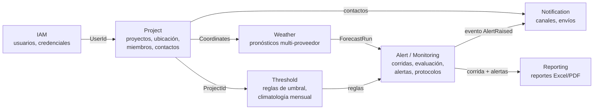

# Modelo de Dominio de Heimdall (v0 – borrador para validación)

> Fuentes: [01_inventario_sarada.md](01_inventario_sarada.md) (dominio legado), [02_estado_actual_heimdall.md](02_estado_actual_heimdall.md) (código actual), decisiones tomadas en la conversación de planificación (Clean Architecture + DDD, multi-usuario/multi-proyecto, multi-proveedor meteorológico y de notificaciones, PostgreSQL + Redis, JWT).
>
> Convención: **[DECISIÓN]** = acordado previamente · **[PROPUESTA]** = recomendación pendiente de validar · **[PREGUNTA Qn]** = requiere respuesta (ver §9).

---

## 1. Cambio conceptual principal: de "un archivo de configuración" a un dominio multi-proyecto

En Sarada todo giraba alrededor de **un único** `ConfigFileThreshold` (un proyecto por instalación, archivos JSON locales). Heimdall cambia tres supuestos de raíz:

| Sarada | Heimdall |
|---|---|
| 1 instalación = 1 proyecto | 1 usuario → N proyectos **[DECISIÓN]** |
| Umbrales como 15 campos planos (`forestFireThresholdOrange`, …) | Umbrales como **reglas** (amenaza × variable × nivel × alcance) **[PROPUESTA]** |
| Contactos SCI = texto + teléfono dentro de la config | Contactos como entidad propia, con canales y suscripción por nivel **[PROPUESTA]** |
| OpenMeteo y WhatsApp cableados | Proveedores detrás de puertos (`WeatherProviderPort`, `NotificationSenderPort`) **[DECISIÓN]** |
| Cron del SO (`schtasks` / `crontab`) | Planificación interna por proyecto (Spring Scheduler) **[DECISIÓN]** |
| Excel como única salida y "registro" (`recordThreshold.json`) | Alertas persistidas como entidad de primera clase; el Excel es solo una vista **[PROPUESTA]** |

### Distinción clave: **Usuario ≠ Contacto**
En Sarada el Jefe SCI **no era un usuario del sistema**: era un nombre y un teléfono al que se enviaba un WhatsApp. En Heimdall conviene mantener esa separación:
- **User (IAM):** alguien que inicia sesión y administra proyectos.
- **Contact (Project):** alguien que **recibe** alertas (Jefe SCI, Auxiliar, brigadista). Puede o no tener cuenta. **[PREGUNTA Q3]**

---

## 2. Bounded Contexts y mapa de relaciones

**Regla de integración [PROPUESTA]:** los contextos se referencian **solo por ID** (`UserId`, `ProjectId`, `ForecastRunId`…), nunca por objetos de otro contexto. Esto es lo que permite partirlos luego en microservicios. **[PREGUNTA Q8]**: ¿se permiten *foreign keys* físicas entre tablas de distintos contextos mientras sea monolito?

---

## 3. Contexto IAM (existente, con brechas)

**Agregado raíz:** `User`

| Elemento | Tipo | Estado | Notas |
|---|---|---|---|
| `UserId` | VO (UUID) | ✅ existe | |
| `Email` | VO | ✅ existe | normalizado, RFC, ≤254 |
| `passwordHash` | String | ✅ existe | BCrypt cost 12, política 8 chars / 72 bytes |
| `Role` | Enum | ✅ existe | `ADMIN, SCI_CHIEF, OPERATOR` |
| `fullName` | String | ❌ falta | **[PROPUESTA]** |
| `phone` | VO `PhoneNumber` (E.164) | ❌ falta | **[PREGUNTA Q3]** |
| `status` | Enum `ACTIVE, SUSPENDED, PENDING_VERIFICATION` | ❌ falta | **[PROPUESTA]** |
| `createdAt / updatedAt / lastLoginAt` | Instant | ❌ falta | **[PROPUESTA]** |
| `RefreshToken` | Entidad | ❌ falta | Fase 2 del plan IAM |

**Problema de diseño detectado:** `Role` hoy es **global** (`SCI_CHIEF` a nivel de toda la plataforma). Pero ser Jefe SCI es algo **por proyecto**. **[PROPUESTA]** dividir en dos niveles:
- `PlatformRole` (IAM): `ADMIN`, `USER` → quién administra la plataforma.
- `ProjectRole` (Project): `OWNER`, `MANAGER`, `OPERATOR`, `VIEWER` → qué puede hacer un usuario dentro de un proyecto. **[PREGUNTA Q2]**

---

## 4. Contexto Project

**Agregado raíz:** `Project`

| Elemento | Tipo | Invariantes / reglas |
|---|---|---|
| `ProjectId` | VO (UUID) | |
| `code` | String | Antes `idProject`. Único por dueño **[PREGUNTA Q4]** |
| `name` | String | No vacío (corrige bug de Sarada que sobrescribía nombre con id) |
| `Location` | VO | `department`, `municipality`, `country` (+ código DANE/DIVIPOLA **[PREGUNTA Q5]**) |
| `Coordinates` | VO | lat ∈ [-90, 90], lon ∈ [-180, 180]; origen `GEOCODED` o `MANUAL` |
| `timezone` | ZoneId | Por defecto `America/Bogota`; necesario para "mañana" = today+1 |
| `status` | Enum | `ACTIVE`, `PAUSED`, `ARCHIVED` |
| `MonitoringSchedule` | VO | hora local de ejecución diaria (antes `hour`/`minute` de `DashboardDto`), `enabled` |
| `ProjectMember` | Entidad hija | (`UserId`, `ProjectRole`) – un proyecto tiene ≥1 `OWNER` |
| `Contact` | Entidad hija | nombre, `SciPosition` (`SCI_CHIEF`, `DEPUTY_SCI_CHIEF`, `BRIGADE_LEADER`, `PMU_LIAISON`, `OTHER`), canales |
| `ContactChannel` | VO | tipo (`WHATSAPP`, `SMS`, `EMAIL`), dirección (E.164 / email), `verified` |
| `AlertSubscription` | VO | qué niveles recibe cada contacto (p. ej. auxiliar solo ROJO) **[PREGUNTA Q6]** |

**Reglas heredadas de Sarada y saneadas:**
- El teléfono se guarda en **E.164** (`+573013338304`) en vez de `long` + concatenar `"57"` → soporta otros países.
- El Auxiliar SCI **sí** puede recibir notificaciones (en Sarada se capturaba pero nunca se usaba – hueco #6).
- Geocodificación es un **puerto** (`GeocodingPort`); Google Maps es solo un adaptador.

---

## 5. Contexto Threshold (núcleo del SAT)

### 5.1 Catálogos del dominio (enums, estables)

| Enum | Valores |
|---|---|
| `Hazard` (amenaza) | `FOREST_FIRE`, `MASS_MOVEMENT`, `WINDSTORM`, `LIGHTNING` |
| `WeatherVariable` | `TEMPERATURE_MAX` (°C), `PRECIPITATION_SUM` (mm), `PRECIPITATION_PROBABILITY` (%), `WIND_SPEED_MAX` (km/h), `RELATIVE_HUMIDITY_MEAN` (%), `WEATHER_CODE` (WMO) |
| `AlertLevel` | `YELLOW`, `ORANGE`, `RED` (ordenados por severidad) |
| `EvaluationScope` | `DAILY` (horizonte 14 días), `MONTHLY` (climatología 6 meses) |
| `Comparator` | `GTE` (≥ valor), `IN_SET` (código ∈ conjunto) |

### 5.2 Agregado `ThresholdProfile` [PROPUESTA]
Un perfil de umbrales por proyecto, compuesto por **reglas**:

`ThresholdRule` = (`Hazard`, `WeatherVariable`, `AlertLevel`, `EvaluationScope`, `Comparator`, `value` | `codeSet`)

**Por qué reglas y no 15 columnas:** resuelve de una vez los huecos #1 (amarillo diario inexistente), #2 (ceráunicos numérico vs código WMO), #7 (rojo de vendaval nunca evaluado) y #10 (mensual de viento/ceráunicos), y permite agregar amenazas/variables sin migrar el esquema.

**Matriz por defecto equivalente a Sarada** (valores de los tests legados como ejemplo):

| Amenaza | Variable | Scope | Amarillo | Naranja | Rojo |
|---|---|---|---|---|---|
| FOREST_FIRE | TEMPERATURE_MAX | DAILY | – | ≥ 25 °C | ≥ 27 °C |
| MASS_MOVEMENT | PRECIPITATION_SUM | DAILY | – | ≥ 20 mm | ≥ 39 mm |
| MASS_MOVEMENT | PRECIPITATION_PROBABILITY | DAILY | – | ≥ 50 % | ≥ 75 % |
| WINDSTORM | WIND_SPEED_MAX | DAILY | – | ≥ 40 km/h | ≥ 50 km/h |
| LIGHTNING | WEATHER_CODE | DAILY | – | – | ∈ {95, 96, 99} |
| FOREST_FIRE | TEMPERATURE_MAX | MONTHLY | – | ≥ x | ≥ y |
| MASS_MOVEMENT | PRECIPITATION_* | MONTHLY | ≥ x | ≥ y | ≥ z |

**Invariantes:**
1. Para una misma (amenaza, variable, scope) con comparador `GTE`: `YELLOW < ORANGE < RED` (monotonía estricta).
2. Clasificación por intervalo semiabierto: el nivel asignado es el **más alto** cuyo umbral se alcanza (regla #8 de Sarada).
3. `IN_SET` solo es válido con `WEATHER_CODE`.
4. Unidades implícitas por variable (no se guardan por regla).

**Versionado [PROPUESTA]:** cada cambio de umbrales crea una nueva versión (`version`, `effectiveFrom`) para que una alerta histórica siempre apunte a las reglas con las que se evaluó. **[PREGUNTA Q7]**

### 5.3 `MonthlyClimatology` (línea base mensual)
- 12 entradas por proyecto: `month (1..12)`, `expectedTemperatureMax (°C)`, `expectedPrecipitation (? – ver Q9)`.
- El semestre se **deriva** del mes (1–6 → S1, 7–12 → S2); no se persiste (`stage` y el bug `"may0"` desaparecen).
- **[PREGUNTA Q9]** La precipitación mensual en Sarada estaba en **%**: ¿es probabilidad media, porcentaje respecto a la media histórica, o en realidad mm?

---

## 6. Contexto Weather

**Agregado raíz:** `ForecastRun` (una consulta a un proveedor para una coordenada)

| Elemento | Tipo | Notas |
|---|---|---|
| `ForecastRunId` | VO | |
| `providerCode` | String | `OPEN_METEO`, `IDEAM`, … (catálogo `WeatherProvider`) |
| `Coordinates` | VO | redondeadas (p. ej. 2–3 decimales) para compartir caché entre proyectos cercanos |
| `fetchedAt` | Instant | |
| `horizonDays` | int | 14 por defecto |
| `DailyForecast` | Entidad hija (×N) | `date`, `temperatureMax`, `windSpeedMax`, `precipitationProbability`, `precipitationSum`, `relativeHumidityMean`, `weatherCode` (todos opcionales: no todo proveedor da todo) |

- `WeatherNode.nextNode` (lista enlazada) desaparece → lista ordenada por fecha.
- Catálogo de referencia `WmoWeatherCode` (código, descripción ES, flags `isThunderstorm`, `isPrecipitation`) reemplaza `ListCodeDTO`.
- **Redis** = caché de corto plazo de la respuesta del proveedor. **[PREGUNTA Q10]** ¿Se persisten también en PostgreSQL (trazabilidad: "con qué pronóstico se disparó esta alerta")?
- Multi-proveedor: estrategia **[PREGUNTA Q11]** (primario + fallback, o proveedor elegido por proyecto).

---

## 7. Contexto Alert / Monitoring (motor de reglas)

### 7.1 `MonitoringRun` (agregado raíz)
Una ejecución de la evaluación para un proyecto en una fecha (reemplaza el modo `--auto`).
- `projectId`, `runDate` (fecha local del proyecto), `trigger` (`SCHEDULED`, `MANUAL`), `forecastRunId`, `thresholdProfileVersion`, `status` (`RUNNING`, `COMPLETED`, `FAILED`), `startedAt`, `finishedAt`, `errorMessage`.
- Invariante: máximo **una** corrida `SCHEDULED` por (proyecto, fecha) → idempotencia.

### 7.2 `Alert` (resultado de evaluación)
Una superación de umbral detectada:
- `hazard`, `variable`, `level`, `scope`, `targetDate` (día/mes pronosticado), `observedValue`, `thresholdValue`, `ruleId`, `leadTimeDays` (`targetDate − runDate`).
- Reemplaza `recordThreshold.json` (con su bug del teléfono mezclado con nombres de alertas – hueco #9).
- **Ciclo de vida [PREGUNTA Q12]:** ¿solo registro inmutable, o estados `OPEN → ACKNOWLEDGED → RESOLVED` con quién la atendió?

### 7.3 `ProtocolDirective` (catálogo de protocolos SCI)
Por (`hazard`, `level`, `scope`): `alertTypeText`, `callChainText`, `actionText`.
- Reemplaza el enum `AlertThreshold` y los textos sueltos de `GenerateSectionSheet` (corrigiendo erratas: "DE DE LAS", "POR POR", "TEMPERATURA" en precipitación, arrays invertidos de vendavales).
- **[PREGUNTA Q13]** ¿Catálogo global fijo, o personalizable por proyecto (con el global como plantilla)?

### 7.4 Política de notificación
Regla Sarada: notificar solo si `targetDate == runDate + 1`. **[PROPUESTA]** convertirlo en parámetro por proyecto (`notifyLeadDays`, por defecto 1) y por nivel mínimo (p. ej. solo ≥ ORANGE). **[PREGUNTA Q14]**

### 7.5 Evento de dominio
`AlertRaised(alertId, projectId, hazard, level, targetDate)` → lo consume Notification (y luego, en microservicios, viajaría por un broker).

---

## 8. Contextos Notification y Reporting

### Notification
- `NotificationDispatch` (agregado): `alertId`, `contactId`, `channel`, `destination`, `templateCode`, `payload`, `status` (`PENDING`, `SENT`, `DELIVERED`, `FAILED`), `providerMessageId`, `attempts`, `sentAt`, `lastError`.
- `NotificationTemplate`: equivale a la plantilla `alert_threshold` de Meta (header = "Roja Incendio Forestal", body = directiva + fecha).
- Credenciales de proveedor (token de Meta, antes en `dashboard.json`) **no** son dominio: van a configuración/secretos. **[PREGUNTA Q15]** ¿una cuenta WhatsApp para toda la plataforma o cada usuario/proyecto trae la suya?

### Reporting
- `Report`: `projectId`, `monitoringRunId`, `format` (`XLSX`, luego `PDF`), `storageKey` (no ruta absoluta del SO), `generatedAt`, `sizeBytes`.
- El contenido (4 hojas + soporte) se **calcula** desde `MonitoringRun` + `Alert` + `DailyForecast`; no se persiste `SheetDataModel`.
- **[PREGUNTA Q16]** ¿Dónde se guardan los archivos (disco local del contenedor, volumen Docker, S3/MinIO) o se generan bajo demanda sin almacenarlos?

---

## 9. Preguntas abiertas (resumen)

| # | Tema | Pregunta |
|---|---|---|
| Q1 | Tenencia | ¿Existe un concepto de **Organización** (empresa/alcaldía que agrupa usuarios y proyectos) o los proyectos pertenecen directamente a usuarios? |
| Q2 | Roles | ¿Separar `PlatformRole` (global) de `ProjectRole` (por proyecto)? |
| Q3 | Contactos | ¿Los contactos SCI son entidades independientes de los usuarios (pueden no tener cuenta)? |
| Q4 | Proyecto | ¿El `code` (antes `idProject`) es obligatorio y único global, por organización o por usuario? |
| Q5 | Ubicación | ¿Solo Colombia (catálogo DIVIPOLA de departamentos/municipios) o multinacional? |
| Q6 | Suscripciones | ¿Cada contacto elige qué niveles/amenazas recibe? |
| Q7 | Versionado | ¿Versionar los perfiles de umbrales para auditoría histórica? |
| Q8 | Integración | ¿FKs físicas entre contextos en el monolito o solo IDs lógicos? |
| Q9 | Climatología | ¿Qué significa el "%" de precipitación mensual? |
| Q10 | Pronósticos | ¿Persistir pronósticos en Postgres además de Redis? |
| Q11 | Proveedores | ¿Fallback automático o proveedor por proyecto? |
| Q12 | Alertas | ¿Alertas con ciclo de vida (acuse/resolución) o inmutables? |
| Q13 | Protocolos | ¿Protocolos globales o personalizables por proyecto? |
| Q14 | Notificación | ¿Antelación (today+1) y nivel mínimo configurables por proyecto? |
| Q15 | Credenciales | ¿Cuenta de WhatsApp de plataforma o por cliente? |
| Q16 | Reportes | ¿Almacenar archivos (dónde) o generar bajo demanda? |
