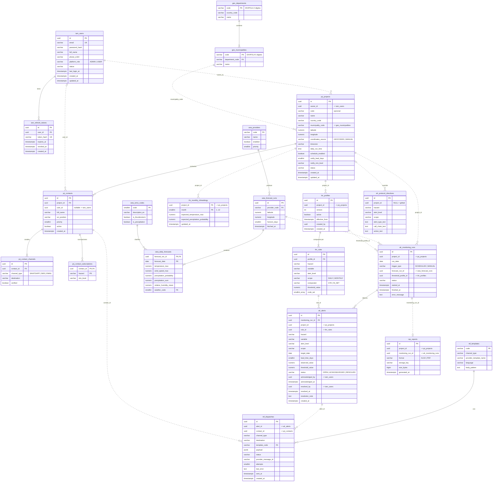

# Modelo Relacional de Heimdall (v1)

> Derivado de [03_modelo_dominio.md](03_modelo_dominio.md) y ajustado con las decisiones de [05_decisiones.md](05_decisiones.md) (D1–D16). Motor objetivo: **PostgreSQL 16**.

## Convenciones
- Prefijo de tabla por bounded context: `iam_`, `prj_`, `geo_`, `thr_`, `wea_`, `alr_`, `ntf_`, `rep_`.
- PK `UUID` en entidades de negocio; claves naturales en catálogos (`code`).
- Enums como `VARCHAR` + `CHECK` (igual que `iam_users.role` hoy).
- Auditoría: `created_at`, `updated_at` (`TIMESTAMPTZ`).
- **D8:** FKs físicas solo **dentro** de un contexto. Entre contextos = FK lógica (línea punteada en el diagrama, sin constraint).

---

## 1. Diagrama Entidad-Relación

---

## 2. Restricciones clave (para el DDL futuro)

| Tabla | Restricción | Decisión |
|---|---|---|
| `iam_users` | `CHECK platform_role IN ('ADMIN','USER')` | D2 |
| `iam_users` | `CHECK status IN ('ACTIVE','SUSPENDED','PENDING_VERIFICATION')` | – |
| `prj_projects` | `UNIQUE (owner_id, code)` (code nullable) | D1, D4 |
| `prj_projects` | `CHECK latitude BETWEEN -90 AND 90 AND longitude BETWEEN -180 AND 180` | VO `Coordinates` |
| `prj_projects` | `CHECK notify_lead_days >= 0`, default `1`; `notify_min_level` default `'ORANGE'` | D14 |
| `prj_contacts` | `CHECK sci_position IN ('SCI_CHIEF','DEPUTY_SCI_CHIEF','BRIGADE_LEADER','PMU_LIAISON','OTHER')` | D3 |
| `prj_contact_channels` | `UNIQUE (contact_id, channel_type, destination)` | – |
| `prj_contact_subscriptions` | `CHECK min_level IN ('YELLOW','ORANGE','RED')` | D6 |
| `thr_profiles` | `UNIQUE (project_id, version)` + índice parcial único `(project_id) WHERE active` | D7 |
| `thr_rules` | `UNIQUE (profile_id, hazard, variable, scope, alert_level)` | – |
| `thr_rules` | `CHECK ((comparator='GTE' AND threshold_value IS NOT NULL) OR (comparator='IN_SET' AND variable='WEATHER_CODE' AND code_set IS NOT NULL))` | – |
| `thr_monthly_climatology` | `CHECK month BETWEEN 1 AND 12`; `expected_precipitation_probability BETWEEN 0 AND 100` | D9 |
| `wea_providers` | `UNIQUE (priority)` | D11 |
| `wea_forecast_runs` | índice `(provider_code, latitude, longitude, fetched_at DESC)` | D10 |
| `alr_monitoring_runs` | índice parcial único `(project_id, run_date) WHERE trigger_type='SCHEDULED'` | idempotencia |
| `alr_alerts` | `CHECK status IN ('OPEN','ACKNOWLEDGED','RESOLVED')`; índice `(project_id, status, target_date)` | D12 |
| `alr_alerts` | `CHECK (status <> 'ACKNOWLEDGED' OR acknowledged_at IS NOT NULL)`, `CHECK (status <> 'RESOLVED' OR resolved_at IS NOT NULL)` | D12 |
| `alr_protocol_directives` | `UNIQUE NULLS NOT DISTINCT (project_id, hazard, alert_level, scope)` | D13 |
| `ntf_dispatches` | `CHECK status IN ('PENDING','SENT','DELIVERED','FAILED')` | – |

**Invariantes que viven en el dominio (no en DDL):**
- Monotonía `YELLOW < ORANGE < RED` entre reglas `GTE` de la misma (perfil, amenaza, variable, scope).
- El usuario solo opera sobre proyectos donde `owner_id = userId` del JWT (salvo `ADMIN`).
- Transiciones de alerta válidas: `OPEN → ACKNOWLEDGED → RESOLVED` (o `OPEN → RESOLVED`).
- Selección de proveedor: el de menor `priority` habilitado; si falla, el siguiente (D11).
- Protocolo efectivo = override del proyecto si existe, si no el global (D13).

---

## 3. Qué reemplaza a cada artefacto de Sarada

| Sarada | Heimdall |
|---|---|
| `threshold.json` (proyecto + contactos + umbrales diarios) | `prj_projects` + `prj_contacts` + `prj_contact_channels` + `thr_profiles`/`thr_rules` (DAILY) |
| `monthlyThreshold.json` | `thr_monthly_climatology` + `thr_rules` (MONTHLY) |
| `listCode.json` | `wea_wmo_codes` |
| `dashboard.json` (hora, directorio, token) | `prj_projects.daily_run_time` + secreto de config (token) + `rep_reports.storage_key` |
| `recordThreshold.json` | `alr_alerts` + `ntf_dispatches` |
| Enum `AlertThreshold` + textos de `GenerateSectionSheet` | `alr_protocol_directives` (corrigiendo erratas) |
| `report-YYYY-MM-DD.xlsx` en disco | `rep_reports` + puerto de almacenamiento |
| `schtasks` / `crontab` | `prj_projects.daily_run_time` + `alr_monitoring_runs` |

---

## 4. Impacto sobre el código actual (informativo, sin cambios aplicados)
- `iam_users`: agregar `full_name`, `phone_e164`, `status`, timestamps; renombrar `role` → `platform_role` con valores `ADMIN/USER` (D2). El registro asignaría `USER` en vez de `OPERATOR`.
- Introducir **Flyway** antes de crear el segundo contexto (hoy: `schema.sql` + `ddl-auto=validate`).
- Datos semilla necesarios: `geo_departments`/`geo_municipalities` (DIVIPOLA), `wea_wmo_codes`, `wea_providers` (`OPEN_METEO` prioridad 1), `alr_protocol_directives` globales, `ntf_templates` (`alert_threshold`).
