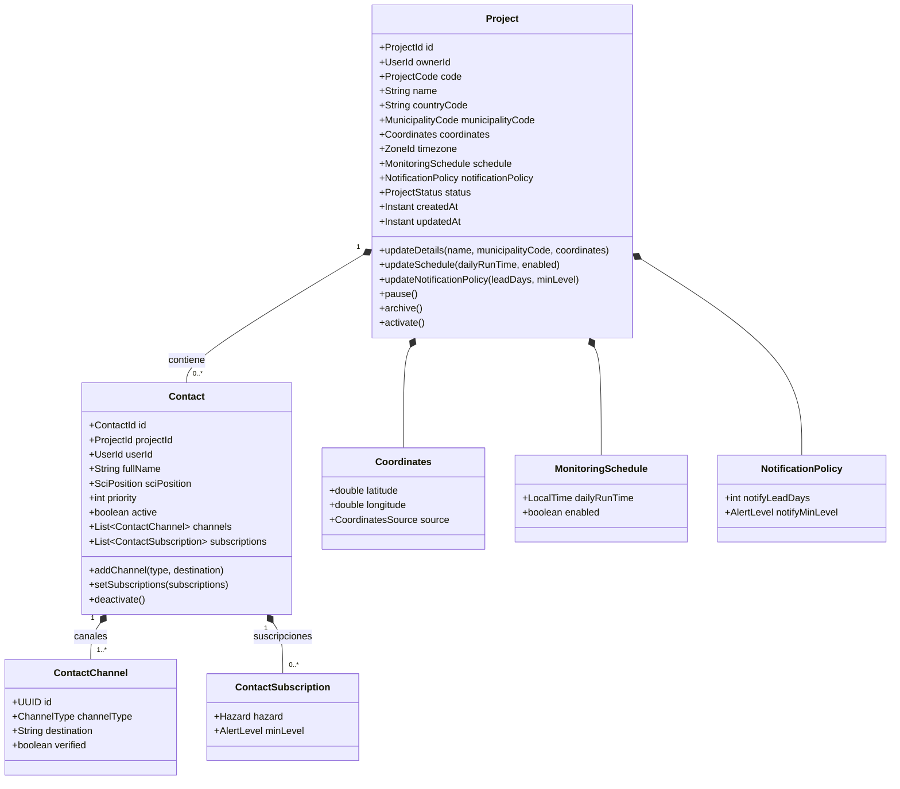
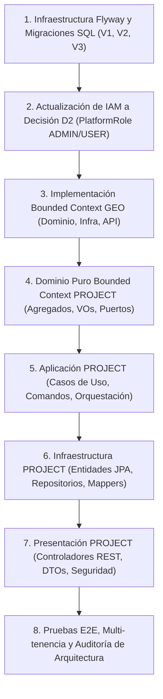

# Plan Técnico de Implementación: Fase 2 (Migraciones Flyway, Catálogo GEO y Bounded Context PRJ)

> **Proyecto:** Heimdall – Sistema de Alerta Temprana Hidrometeorológico  
> **Versión del Plan:** 1.0  
> **Fecha:** 2026-10-14  
> **Marco Arquitectónico:** Clean Architecture + Domain-Driven Design (DDD) + Hexagonal Architecture  
> **Lineamientos de Base:** [03_modelo_dominio.md](03_modelo_dominio.md), [04_modelo_relacional.md](04_modelo_relacional.md), [05_decisiones.md](05_decisiones.md) (Decisiones D1 a D16) y [06_esquema_ddl_postgres.sql](06_esquema_ddl_postgres.sql).

---

## 1. Objetivos y Alcance de la Fase 2

La Fase 2 tiene como propósito transformar el modelo conceptual y relacional acordado en un núcleo de software ejecutable y robusto para la gestión territorial y de proyectos, asegurando que el backend pase de un esquema de inicio efímero (`schema.sql`) a un ciclo de vida de base de datos profesional y versionado con **Flyway**.

### Objetivos Clave:
1. **Versionamiento de Base de Datos con Flyway:**
   - Desactivar la inicialización estática `spring.sql.init.mode=always` y sustituirla por scripts de migración versionados (`V1`, `V2`, `V3`) derivados de `06_esquema_ddl_postgres.sql`.
   - Garantizar compatibilidad dual: PostgreSQL 16 para producción/desarrollo y H2 (modo PostgreSQL) para ejecución de pruebas automatizadas en suite Gradle.
2. **Alineación de IAM con la Decisión D2:**
   - Migrar el enum `Role` (`ADMIN`, `SCI_CHIEF`, `OPERATOR`) a `PlatformRole` (`ADMIN`, `USER`), trasladando la posición operativa del SCI a los contactos del proyecto.
   - Añadir soporte de auditoría básica y campos de perfil en la entidad `iam_users`.
3. **Implementación del Bounded Context `geo` (Catálogo Territorial):**
   - Catálogo inmutable de Departamentos y Municipios basado en la codificación oficial DIVIPOLA de Colombia.
   - Puertos de consulta y endpoints de lectura optimizados para alimentar la geocodificación y selectores de interfaz.
4. **Implementación del Bounded Context `prj` (Gestión de Proyectos y Contactos Operativos):**
   - **Agregado `Project`:** Tenencia estricta por dueño (`owner_id`), código nemotécnico opcional único por dueño, coordenadas geográficas validadas, zona horaria, planificación de monitoreo diario y política de notificación.
   - **Entidad / Agregado `Contact`:** Gestión de integrantes del Sistema de Comando de Incidentes (SCI), canales verificables (WhatsApp en formato E.164, SMS, Email) y matriz de suscripción granular a amenazas (`FOREST_FIRE`, `MASS_MOVEMENT`, `WINDSTORM`, `LIGHTNING`) y severidades mínimas (`YELLOW`, `ORANGE`, `RED`).
   - Aplicación estricta de la regla **D8**: Claves foráneas físicas exclusivamente dentro del contexto `prj`; referencias lógicas hacia `iam` y `geo`.
5. **Aislamiento Arquitectónico y Suite de Pruebas:**
   - Extensión de `DomainArchitectureTest` para certificar la pureza de `geo.domain` y `prj.domain`.
   - Pruebas unitarias de invariantes, pruebas de repositorio JPA y pruebas de integración REST con verificación de autorización y multi-tenencia.

---

## 2. Estrategia de Migraciones con Flyway

### 2.1 Dependencias Requeridas (`build.gradle.kts`)
Se deben incorporar los starters y controladores de migración:
```kotlin
implementation("org.flywaydb:flyway-core")
implementation("org.flywaydb:flyway-database-postgresql")
```

### 2.2 Reorganización de Scripts en `src/main/resources/db/migration/`
Se sustituye `src/main/resources/db/schema.sql` por migraciones versionadas:

* **`V1__iam_base.sql`:**
  - Creación de `iam_users` con `platform_role IN ('ADMIN', 'USER')` (D2), `full_name`, `phone_e164`, `status` y timestamps `created_at`, `updated_at`.
  - Creación de tabla `iam_refresh_tokens` para la fase de renovación de tokens.
  - Migración o inserción de datos iniciales requeridos.

* **`V2__geo_catalogs.sql`:**
  - Creación de `geo_departments` (PK `code VARCHAR(2)`) y `geo_municipalities` (PK `code VARCHAR(5)`, FK física a departamento).
  - Carga de catálogo semilla DIVIPOLA (Antioquia, Cundinamarca, Bogotá D.C., Valle del Cauca, Santander, etc. extraídos de `06_esquema_ddl_postgres.sql`).

* **`V3__prj_projects_and_contacts.sql`:**
  - Creación de `prj_projects` (PK `UUID`, `owner_id` lógico, coordenadas, schedule, políticas D14).
  - Creación de `prj_contacts` (PK `UUID`, FK física a `prj_projects`, `sci_position`).
  - Creación de `prj_contact_channels` (PK `UUID`, FK física a `prj_contacts`, tipo y destino E.164/email).
  - Creación de `prj_contact_subscriptions` (PK compuesta `(contact_id, hazard)`, FK física a `prj_contacts`).
  - Índices especializados: `idx_prj_projects_owner_id`, `idx_prj_projects_schedule`, `idx_prj_contacts_project_active`, `idx_prj_contact_channels_contact_id`.

### 2.3 Estrategia de Configuración Dual (PostgreSQL vs H2 en Tests)
* **`application.properties` (Producción / Local):**
  ```properties
  spring.flyway.enabled=true
  spring.flyway.locations=classpath:db/migration
  spring.jpa.hibernate.ddl-auto=validate
  spring.sql.init.mode=never
  ```
* **`application-test.properties` (Suite JUnit en memoria):**
  ```properties
  spring.flyway.enabled=true
  spring.flyway.locations=classpath:db/migration
  spring.jpa.hibernate.ddl-auto=validate
  # Se asegura compatibilidad H2 con sintaxis PostgreSQL (UUID, checks, indices)
  ```

---

## 3. Arquitectura y Paquetería de la Solución

Se conserva la estructura concéntrica Clean Architecture / Hexagonal ya establecida en el proyecto:

```
src/main/java/com/example/heimdall/
├── HeimdallApplication.java
├── iam/                                         # Contexto existente (actualizado a D2)
│   ├── domain/ ...
│   ├── application/ ...
│   ├── infrastructure/ ...
│   └── presentation/ ...
│
├── geo/                                         # Contexto Catálogo Territorial (D5)
│   ├── domain/
│   │   ├── model/                               # Department, Municipality, DepartmentCode, MunicipalityCode
│   │   ├── port/
│   │   │   ├── in/                              # GetDepartmentUseCase, ListDepartmentsUseCase, etc.
│   │   │   └── out/                             # DepartmentRepositoryPort, MunicipalityRepositoryPort
│   │   └── exception/                           # DepartmentNotFoundException, MunicipalityNotFoundException
│   ├── application/
│   │   └── usecase/                             # GeoCatalogQueryService
│   ├── infrastructure/
│   │   ├── persistence/
│   │   │   ├── entity/                          # DepartmentJpaEntity, MunicipalityJpaEntity
│   │   │   ├── repository/                      # SpringDataDepartmentRepository, SpringDataMunicipalityRepository
│   │   │   ├── mapper/                          # GeoPersistenceMapper
│   │   │   └── PostgresGeoRepositoryAdapter.java
│   │   └── config/                              # GeoConfiguration (inyección de Beans)
│   └── presentation/
│       ├── rest/                                # GeoCatalogController
│       └── dto/response/                        # DepartmentResponseDto, MunicipalityResponseDto
│
└── project/                                     # Contexto Project Management & Contactos (D1, D3, D4, D6, D8, D14)
    ├── domain/
    │   ├── model/
    │   │   ├── Project.java                     # Agregado Raíz
    │   │   ├── ProjectId.java                   # VO (UUID)
    │   │   ├── ProjectCode.java                 # VO (código opcional alfanumérico)
    │   │   ├── Coordinates.java                 # VO (latitud, longitud, CoordinatesSource)
    │   │   ├── MonitoringSchedule.java          # VO (dailyRunTime, enabled)
    │   │   ├── NotificationPolicy.java          # VO (notifyLeadDays, notifyMinLevel)
    │   │   ├── ProjectStatus.java               # Enum (ACTIVE, PAUSED, ARCHIVED)
    │   │   ├── Contact.java                     # Entidad hija / Agregado
    │   │   ├── ContactId.java                   # VO (UUID)
    │   │   ├── SciPosition.java                 # Enum (SCI_CHIEF, DEPUTY_SCI_CHIEF, ...)
    │   │   ├── ContactChannel.java              # Entidad/VO (channelType, destination, verified)
    │   │   ├── ChannelType.java                 # Enum (WHATSAPP, SMS, EMAIL)
    │   │   ├── ContactSubscription.java         # VO (Hazard, AlertLevel)
    │   │   ├── Hazard.java                      # Enum (FOREST_FIRE, MASS_MOVEMENT, WINDSTORM, LIGHTNING)
    │   │   └── AlertLevel.java                  # Enum (YELLOW, ORANGE, RED)
    │   ├── port/
    │   │   ├── in/                              # CreateProjectUseCase, GetProjectUseCase, ManageContactsUseCase...
    │   │   └── out/                             # ProjectRepositoryPort, ContactRepositoryPort, GeoValidationPort
    │   └── exception/                           # ProjectNotFoundException, DuplicateProjectCodeException...
    ├── application/
    │   ├── dto/                                 # Comandos de aplicación (CreateProjectCommand, etc.)
    │   └── usecase/                             # ProjectCommandService, ProjectQueryService, ContactService
    ├── infrastructure/
    │   ├── persistence/
    │   │   ├── entity/                          # ProjectJpaEntity, ContactJpaEntity, ChannelJpaEntity, SubJpaEntity
    │   │   ├── repository/                      # SpringDataProjectRepository, SpringDataContactRepository
    │   │   ├── mapper/                          # ProjectPersistenceMapper, ContactPersistenceMapper
    │   │   └── PostgresProjectRepositoryAdapter.java
    │   ├── adapter/
    │   │   └── GeoValidationAdapter.java        # Implementa GeoValidationPort consultando geo.domain.port.in
    │   └── config/                              # ProjectConfiguration (cableado manual de beans)
    └── presentation/
        ├── rest/                                # ProjectController, ContactController, ProjectExceptionHandler
        └── dto/
            ├── request/                         # CreateProjectRequestDto, CreateContactRequestDto...
            └── response/                        # ProjectResponseDto, ContactResponseDto...
```

---

## 4. Diseño Detallado: Bounded Context `geo`

### 4.1 Dominio Puro (`geo.domain`)
* **`DepartmentCode` (Record VO):** Valida longitud exacta de 2 caracteres numéricos (`05`, `11`, `25`, etc.).
* **`MunicipalityCode` (Record VO):** Valida longitud exacta de 5 caracteres numéricos (`05113`, `11001`, etc.).
* **`Department` (Record / Entity):** `DepartmentCode code`, `String countryCode` (default "CO"), `String name`.
* **`Municipality` (Record / Entity):** `MunicipalityCode code`, `DepartmentCode departmentCode`, `String name`.
* **Puertos de Entrada:**
  - `ListDepartmentsUseCase`: `List<Department> execute(String countryCode)`
  - `GetDepartmentUseCase`: `Department execute(DepartmentCode code)`
  - `ListMunicipalitiesByDepartmentUseCase`: `List<Municipality> execute(DepartmentCode departmentCode)`
  - `GetMunicipalityUseCase`: `Municipality execute(MunicipalityCode code)`
* **Puertos de Salida:**
  - `DepartmentRepositoryPort`: `List<Department> findAll()`, `Optional<Department> findByCode(DepartmentCode code)`
  - `MunicipalityRepositoryPort`: `List<Municipality> findByDepartment(DepartmentCode departmentCode)`, `Optional<Municipality> findByCode(MunicipalityCode code)`, `boolean existsByCode(MunicipalityCode code)`

### 4.2 Endpoints REST (`geo.presentation`)
* `GET /api/v1/geo/departments` $\rightarrow$ Lista todos los departamentos de Colombia (`200 OK`).
* `GET /api/v1/geo/departments/{code}` $\rightarrow$ Detalle de departamento (`200 OK` o `404 Not Found`).
* `GET /api/v1/geo/departments/{code}/municipalities` $\rightarrow$ Lista municipios de dicho departamento (`200 OK`).
* `GET /api/v1/geo/municipalities/{code}` $\rightarrow$ Detalle de un municipio por código DIVIPOLA (`200 OK` o `404 Not Found`).

---

## 5. Diseño Detallado: Bounded Context `project`

### 5.1 Agregado Raíz: `Project`
Encapsula la unidad de coherencia transaccional y tenencia multi-inquilino.



#### Invariantes y Reglas de Negocio en `Project`:
1. **Tenencia (D1):** `ownerId` es obligatorio e inmutable tras la creación. Cada operación de mutación o lectura valida que el `UserId` del token coincida con `ownerId` (o que el usuario sea `ADMIN`).
2. **Código de Proyecto (D4):** Opcional, pero si se define, debe normalizarse (letras, números, guiones) y el repositorio valida unicidad `(ownerId, code)`.
3. **Coordenadas Geográficas:** Latitud $\in [-90, 90]$, Longitud $\in [-180, 180]$.
4. **Política de Notificación (D14):** `notifyLeadDays >= 0` (por defecto 1 día de antelación), `notifyMinLevel` solo puede ser `YELLOW`, `ORANGE` o `RED` (por defecto `ORANGE`).
5. **Ciclo de Vida:** Un proyecto en estado `ARCHIVED` no permite modificaciones operativas ni ejecuciones de monitoreo programadas.

#### Invariantes y Reglas de Negocio en `Contact`:
1. **Posición SCI (D2, D3):** `sciPosition` modela la jerarquía operativa (`SCI_CHIEF`, `DEPUTY_SCI_CHIEF`, `BRIGADE_LEADER`, `PMU_LIAISON`, `OTHER`).
2. **Prioridad de Escalamiento:** Entero positivo (`priority > 0`). 1 es la máxima prioridad para despacho de alertas.
3. **Validación de Canales:**
   - Si `channelType == WHATSAPP` o `SMS`: El destino debe cumplir con la especificación internacional **E.164** (ej. `+573013338304`). Corrige la debilidad de Sarada que concatenaba `57` como número entero.
   - Si `channelType == EMAIL`: Debe cumplir el formato RFC estándar normalizado.
4. **Suscripciones a Amenazas (D6):**
   - Máximo una suscripción por amenaza (`FOREST_FIRE`, `MASS_MOVEMENT`, `WINDSTORM`, `LIGHTNING`).
   - Define el umbral mínimo a partir del cual el contacto desea recibir notificaciones en su canal.

### 5.2 Puertos de Entrada y Casos de Uso (`project.domain.port.in`)
* **`CreateProjectUseCase`:** Recibe datos de proyecto, valida existencia del municipio con `GeoValidationPort`, verifica unicidad del código y persiste el nuevo proyecto asignando el `ownerId` del usuario autenticado.
* **`GetProjectUseCase`:** Consulta proyecto por ID y valida acceso de tenencia.
* **`ListProjectsUseCase`:** Retorna proyectos del propietario autenticado.
* **`UpdateProjectUseCase`:** Permite actualizar nombre, ubicación, coordenadas, zona horaria y políticas.
* **`ChangeProjectStatusUseCase`:** Transiciones de estado (`ACTIVE`, `PAUSED`, `ARCHIVED`).
* **`ManageProjectContactsUseCase`:** Casos de uso dedicados para alta, edición, baja lógica, configuración de canales y matriz de suscripción de contactos.

### 5.3 Puertos de Salida (`project.domain.port.out`)
* **`ProjectRepositoryPort`:**
  - `Project save(Project project)`
  - `Optional<Project> findById(ProjectId id)`
  - `List<Project> findByOwnerId(UserId ownerId)`
  - `boolean existsByOwnerIdAndCode(UserId ownerId, ProjectCode code)`
  - `void delete(ProjectId id)`
* **`ContactRepositoryPort`:**
  - `Contact save(Contact contact)`
  - `Optional<Contact> findById(ContactId id)`
  - `List<Contact> findByProjectId(ProjectId projectId)`
  - `void delete(ContactId id)`
* **`GeoValidationPort` (Desacoplamiento Cross-Context D8):**
  - `boolean isValidMunicipality(MunicipalityCode code)`
  - Implementado por `GeoValidationAdapter` en la infraestructura de `project`, que invoca el caso de uso de `geo` sin acoplar los dominios.

### 5.4 Contratos de API REST (`project.presentation`)

| Método | Endpoint | Roles Permitidos | Descripción |
|---|---|---|---|
| `POST` | `/api/v1/projects` | `USER`, `ADMIN` | Crea un proyecto para el usuario autenticado. |
| `GET` | `/api/v1/projects` | `USER`, `ADMIN` | Lista los proyectos propios del usuario. |
| `GET` | `/api/v1/projects/{id}` | `USER`, `ADMIN` | Obtiene el detalle completo del proyecto (con validación de dueño). |
| `PUT` | `/api/v1/projects/{id}` | `USER`, `ADMIN` | Modifica configuración, ubicación y parámetros del proyecto. |
| `PATCH` | `/api/v1/projects/{id}/status` | `USER`, `ADMIN` | Cambia estado (`ACTIVE`, `PAUSED`, `ARCHIVED`). |
| `POST` | `/api/v1/projects/{id}/contacts` | `USER`, `ADMIN` | Registra un nuevo contacto operativo en el proyecto. |
| `GET` | `/api/v1/projects/{id}/contacts` | `USER`, `ADMIN` | Lista los contactos operativos del proyecto ordenados por prioridad. |
| `GET` | `/api/v1/projects/{id}/contacts/{contactId}` | `USER`, `ADMIN` | Detalle del contacto, sus canales y suscripciones. |
| `PUT` | `/api/v1/projects/{id}/contacts/{contactId}` | `USER`, `ADMIN` | Actualiza datos y posición SCI del contacto. |
| `DELETE` | `/api/v1/projects/{id}/contacts/{contactId}` | `USER`, `ADMIN` | Elimina o desactiva el contacto operativo. |
| `PUT` | `/api/v1/projects/{id}/contacts/{contactId}/subscriptions` | `USER`, `ADMIN` | Reemplaza la matriz de suscripciones a amenazas del contacto. |

---

## 6. Plan de Migración de IAM (Alineación D2)

### 6.1 Cambio de Modelo
* En `iam.domain.model.Role`: Migrar a `PlatformRole` con valores `ADMIN` y `USER`.
* En `User.java`: Asignar por defecto `PlatformRole.USER` en registros públicos (`RegisterUserService`).
* En `UserJpaEntity`: Modificar constraint check a `role IN ('ADMIN', 'USER')`.
* En `JwtTokenServiceAdapter`: Emitir claim de rol como `ADMIN` o `USER`.
* En `SecurityConfiguration`: Reglas basadas en `hasRole('ADMIN')` o `hasAnyRole('USER', 'ADMIN')`.

### 6.2 Migración de Datos Existentes en Flyway (`V1__iam_base.sql`)
Cualquier registro existente con rol `OPERATOR` o `SCI_CHIEF` se migra a `USER`:
```sql
UPDATE iam_users SET role = 'USER' WHERE role IN ('OPERATOR', 'SCI_CHIEF');
```

---

## 7. Plan de Pruebas y Criterios de Aceptación

### 7.1 Pruebas de Arquitectura Hexagonal
* Extender `DomainArchitectureTest` para verificar que:
  - `com.example.heimdall.geo.domain` solo importa `java.*` y su propio subpaquete.
  - `com.example.heimdall.project.domain` solo importa `java.*` y su propio subpaquete.

### 7.2 Pruebas Unitarias de Dominio
* Validaciones de `Project`:
  - Rechazo de coordenadas fuera de rango.
  - Rechazo de políticas de notificación inválidas.
  - Comportamiento de cambios de estado y validación de invariantes.
* Validaciones de `Contact` y `ContactChannel`:
  - Aceptación de teléfonos E.164 válidos (`+573013338304`, `+14155552671`) y rechazo de números mal formados (`3013338304`, `abc`, `+000`).
  - Validación de correo electrónico RFC.
  - Unicidad de suscripciones por tipo de amenaza.

### 7.3 Pruebas de Persistencia JPA
* Verificación de persistencia en cascada de `Contact` $\rightarrow$ `ContactChannel` y `ContactSubscription`.
* Verificación de que eliminar un proyecto elimina en cascada sus contactos y canales (integridad física intra-contexto).
* Comprobación del índice de unicidad `uk_prj_projects_owner_code`.

### 7.4 Pruebas de Integración REST y Multi-Tenencia
* Creación de proyecto exitosa y verificación de asignación automática de `owner_id`.
* **Prueba de Tenencia Negativa:** Usuario B intenta consultar o modificar un proyecto creado por Usuario A $\rightarrow$ `403 Forbidden` o `404 Not Found`.
* Validación de formato en DTOs con respuestas `400 Bad Request` ante campos inválidos.

---

## 8. Fases de Ejecución Paso a Paso



| Tarea | Entregables Principales | Verificación |
|---|---|---|
| **T1: Flyway & Migraciones** | `build.gradle.kts`, `V1__iam_base.sql`, `V2__geo_catalogs.sql`, `V3__prj_projects_and_contacts.sql` | `./gradlew test` con Flyway ejecutando migraciones sobre H2 y validación de Hibernate activa. |
| **T2: Ajuste IAM (D2)** | `PlatformRole.java`, actualización de `User`, `RegisterUserService`, `SecurityConfiguration` | Pruebas existentes de IAM actualizadas y pasando al 100%. |
| **T3: Contexto GEO** | Paquete `com.example.heimdall.geo` completo con lectura DIVIPOLA y endpoints REST. | Tests unitarios de VOs y tests de integración `GeoCatalogControllerTest`. |
| **T4: Dominio PROJECT** | Clases de dominio inmutables: `Project`, `Contact`, `Coordinates`, `NotificationPolicy`, puertos in/out. | Pruebas unitarias de invariantes y `DomainArchitectureTest` exitosa. |
| **T5: Aplicación PROJECT** | Casos de uso de creación, actualización y gestión de contactos sin dependencias de Spring. | Pruebas unitarias con mocks de puertos. |
| **T6: Persistencia PROJECT** | Entidades JPA con integridad en cascada, `SpringData` repositorios, mappers y adaptadores. | Pruebas `@DataJpaTest` verificando inserciones y cascades. |
| **T7: API REST PROJECT** | `ProjectController`, `ContactController`, DTOs Jakarta Validation, seguridad por tenencia. | Pruebas `MockMvc` con tokens JWT para usuarios autorizados y no autorizados. |
| **T8: Cierre y Auditoría** | Suite completa de pruebas, verificación de cobertura y reporte final. | `./gradlew check` exitoso sin violaciones arquitectónicas. |
